# Rundgang durch die Weboberfläche

Dieser Rundgang zeigt jede Seite der Weboberfläche von openccu-lite in der Reihenfolge, in der Sie ihr auf einem neuen
System begegnen: Einrichtung und Anmeldung, die Statusseite, die Bedienung, die Seiten im Menü **System**, die
Zusatzsoftware mit dem Homematic Manager und zuletzt Namen, Räume und Gewerke. Die Oberfläche kommt von
[occulited](https://github.com/hobbyquaker/occulited), dem Systemdienst von openccu-lite; sie ist auf Deutsch und
Englisch verfügbar und hat ein helles und ein dunkles Design (Einstellungen → Design, oder wie das Betriebssystem es
vorgibt). Jedes Bild gibt es in beiden Designs: Ihr Browser zeigt das, das zu seiner eigenen Einstellung passt.

Die Bilder zeigen die Version `1.0.0-rc.0`. Die meisten sind mit erfundenen Beispieldaten entstanden: Namen, Adressen
(`192.0.2.x`, `198.51.100.x`, `2001:db8::`), Seriennummern und Geräte gibt es so nicht; Seriennummern, Geräteadressen
und SGTINs sind zusätzlich mit `X` unkenntlich gemacht. Der Homematic Manager läuft dabei mit seinen eigenen
Beispieldaten. Von echten Systemen stammen die Lizenzen-Seite, der Startablauf und die Beispiele für
Funk-Konfigurationen; auch dort sind Seriennummern, SGTINs, Funkadressen, MAC- und IP-Adressen und Namen unkenntlich
gemacht.

**Inhalt:** [Erster Start](#erster-start) · [Anmeldung](#anmeldung) · [Status](#status) · [Bedienung](#bedienung) ·
[Das System-Menü](#das-system-menü) · [Beispiele für Funk-Konfigurationen](#beispiele-für-funk-konfigurationen) ·
[Einstellungen, Konto, Lizenzen, Ausschalten](#einstellungen-konto-lizenzen-ausschalten) ·
[Zusatzsoftware](#zusatzsoftware) · [Homematic Manager](#homematic-manager) ·
[Namen, Räume und Gewerke](#namen-räume-und-gewerke) · [Auf dem Smartphone](#auf-dem-smartphone)

## Erster Start

### Administrator anlegen

<picture><source media="(prefers-color-scheme: dark)" srcset="01-einrichtung-dunkel.png">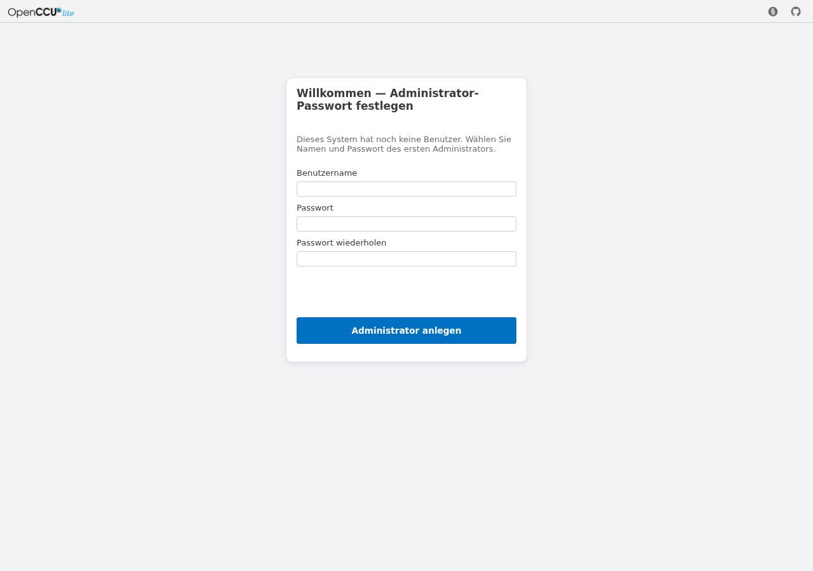</picture>

Ein frisch installiertes System hat noch keine Benutzer. Die erste Seite legt den ersten Administrator an:
Benutzername und Passwort (mindestens acht Zeichen).

### Willkommen

<picture><source media="(prefers-color-scheme: dark)" srcset="02-willkommen-dunkel.png">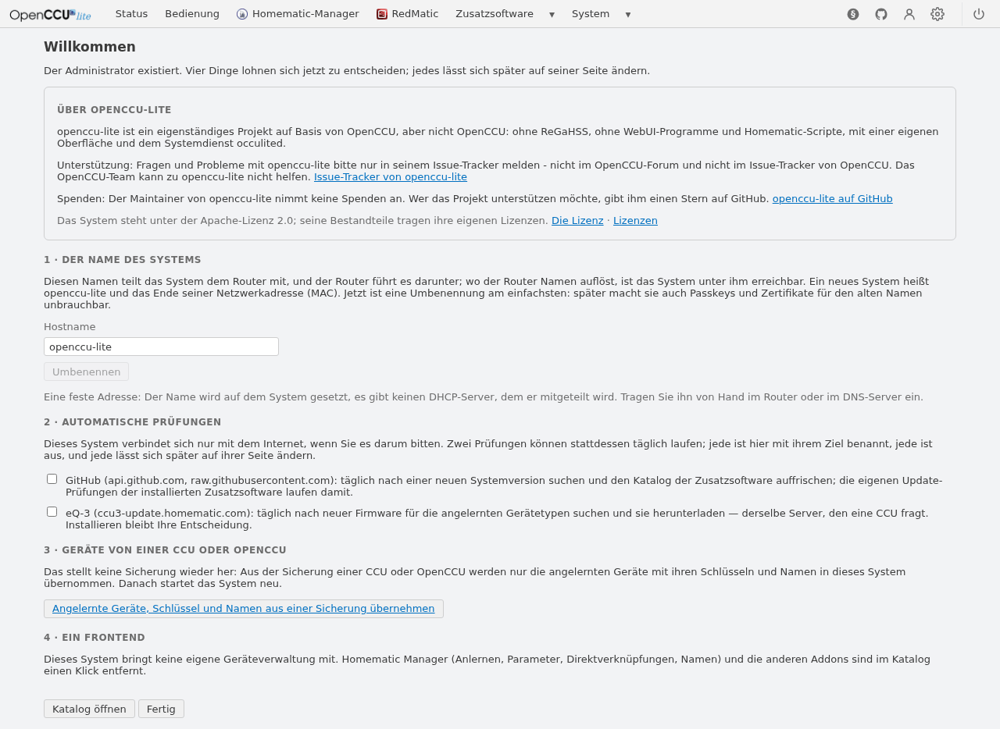</picture>

Direkt danach erklärt die Willkommensseite, was openccu-lite ist (ein eigenständiges Projekt auf Basis von OpenCCU, ohne
ReGaHSS, ohne WebUI-Programme und Homematic-Scripte) und wohin Fragen und Fehlerberichte gehören. Dann fragt sie vier
Dinge, die sich später jederzeit auf ihrer eigenen Seite ändern lassen:

1. **Der Name des Systems.** Ein neues System heißt `openccu-lite` und das Ende seiner MAC-Adresse. Jetzt ist eine
   Umbenennung am einfachsten; später macht sie Passkeys und Zertifikate für den alten Namen unbrauchbar.
2. **Automatische Prüfungen.** Von sich aus verbindet sich das System nicht mit dem Internet. Zwei tägliche Prüfungen
   lassen sich hier einschalten, jede mit ihrem Ziel benannt und beide zunächst aus: GitHub (neue Systemversion,
   Katalog der Zusatzsoftware und deren eigene Update-Prüfungen) und eQ-3 (neue Firmware für die angelernten
   Gerätetypen). Was das System genau wohin sendet, steht in [privacy.md](../privacy.md).
3. **Geräte von einer CCU oder OpenCCU.** „Angelernte Geräte, Schlüssel und Namen aus einer Sicherung übernehmen“
   führt zu System → Sicherung: Dort wird die Sicherung (`.sbk`) der alten Zentrale geprüft, dann kommen die angelernten
   Geräte aller Funkschnittstellen mit ihren Schlüsseln und die Namen, Räume und Gewerke herüber. Das ist keine
   Wiederherstellung, sondern nur die Übernahme der Geräte, und es geht nur, solange auf dem neuen System noch kein
   Gerät angelernt ist; danach startet das System neu. Wenn Sie OpenCCU an Ort und Stelle gewechselt haben, sind die
   Geräte schon da und die Namen werden beim ersten Start übernommen, siehe [switching.de.md](../switching.de.md).
4. **Ein Frontend.** openccu-lite bringt keine eigene Geräteverwaltung mit; der Homematic Manager (Anlernen,
   Parameter, Direktverknüpfungen, Namen) und die anderen Addons sind im Katalog einen Klick entfernt.

## Anmeldung

<picture><source media="(prefers-color-scheme: dark)" srcset="03-anmeldung-dunkel.png">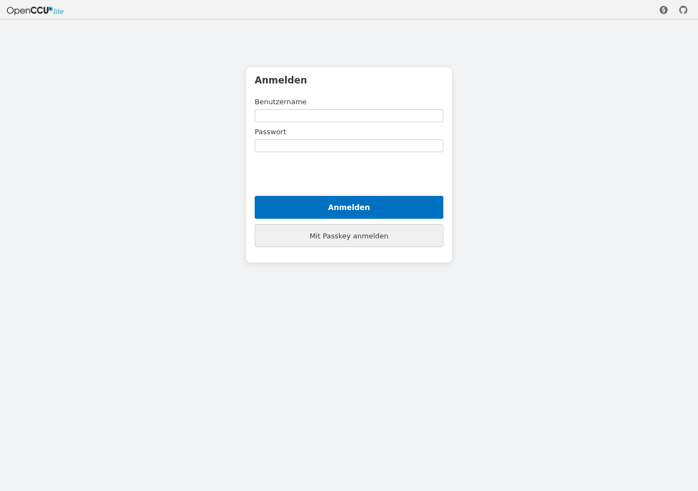</picture>

Jede Seite der Oberfläche verlangt eine Anmeldung, auch die Seiten der Zusatzsoftware: mit Benutzername und Passwort
oder mit einem **Passkey** (unter Konto hinzugefügt, siehe [Konto](#konto)). Außerdem kann das System Anmeldungen über
einen OpenID-Connect-Anbieter annehmen (System → Benutzer); dann erscheint hier ein zusätzlicher Button, siehe
[OpenID Connect](#openid-connect). Oben rechts stehen auch ohne Anmeldung die Lizenzen und der Link zum Projekt auf
GitHub.

## Status

<picture><source media="(prefers-color-scheme: dark)" srcset="04-status-dunkel.png">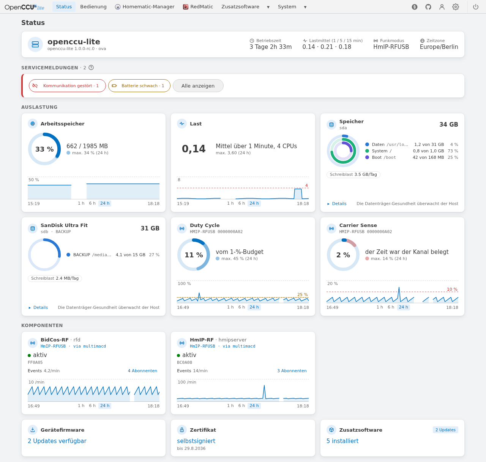</picture>

Die Startseite nach der Anmeldung. Oben der Name des Systems mit der Version von openccu-lite und der Plattform, dazu
Betriebszeit, Last, Funkmodus und Zeitzone. Darunter, wenn es welche gibt, die **Warnungen** des Systems (etwa ein
Sicherungsziel auf dem System selbst oder ein Zertifikat, das bald abläuft), jede mit einem Link auf die Seite, die das
Problem behebt, und mit der Möglichkeit, sie für eine Weile stummzuschalten.

- **Servicemeldungen** der Geräte, nach Art zusammengefasst: gestörte Kommunikation, schwache Batterie und Ähnliches.
  „Alle anzeigen“ klappt die Liste auf, mit Bild und Name des Geräts, Raum, Schnittstelle und seit wann; Meldungen,
  die sich bestätigen lassen, bestätigt ein Klick, auch alle auf einmal.
- **Auslastung:** Arbeitsspeicher und Last mit ihrem Verlauf über eine Stunde, sechs oder 24 Stunden, jeder
  Datenträger mit seinen Partitionen, seiner Schreiblast und unter „Details“ seiner Gesundheit (Alter, Abnutzung und
  Fehler etwa einer SD-Karte; auf einer VM überwacht das der Host), und je Funkmodul **Duty Cycle** und **Carrier
  Sense**.
- **Komponenten:** die Funk-Schnittstellen mit ihrem Modul, ihren Ereignissen pro Minute und ihren Abonnenten,
  verfügbare Gerätefirmware, das Zertifikat und die installierte Zusatzsoftware mit ihren Updates; jede Kachel führt
  auf ihre Seite.

<picture><source media="(prefers-color-scheme: dark)" srcset="69-status-servicemeldungen-dunkel.png">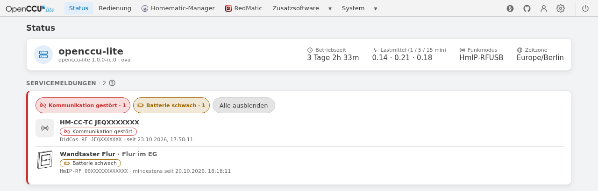</picture>

## Bedienung

<picture><source media="(prefers-color-scheme: dark)" srcset="05-bedienung-dunkel.png">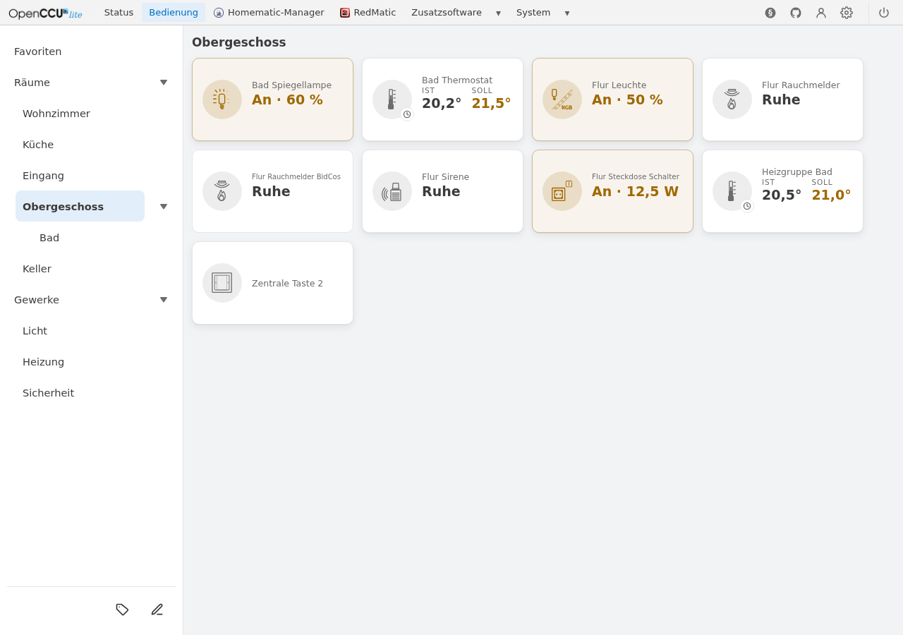</picture>

**Bedienung** ist die eingebaute Oberfläche, mit der Sie das Haus bedienen. Links die Favoriten, die Räume und Gewerke
als aufklappbarer Baum; rechts die Kanäle des gewählten Raums oder Gewerks als Kacheln, mit ihrem Zustand (an, 60 %,
20,2 °C …). Ein Klick auf den runden Knopf schaltet einen Kanal direkt, ein Klick auf die Kachel öffnet seine
Bedienung:

<picture><source media="(prefers-color-scheme: dark)" srcset="06-bedienung-kanal-dunkel.png">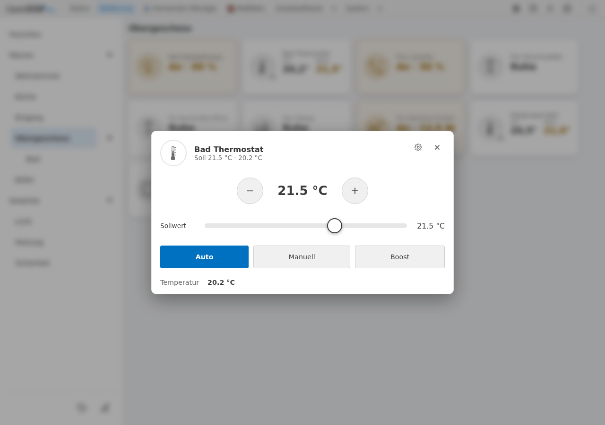</picture>

Ein Thermostat zeigt Soll- und Isttemperatur und die Betriebsarten, ein Dimmer seinen Helligkeitsregler, eine
Farbleuchte Farbe und Farbtemperatur. Die Kacheln kennen die meisten Gerätearten:

<picture><source media="(prefers-color-scheme: dark)" srcset="65-bedienung-wohnzimmer-dunkel.png">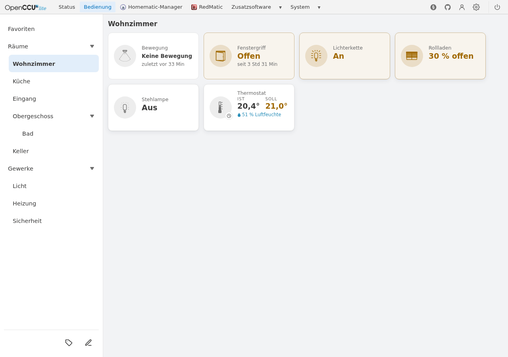</picture>

Ein **Rollladen** oder eine Jalousie zeigt, wie weit er offen ist; der runde Knopf fährt ihn auf, zu oder hält ihn an,
und während er fährt, zeigt die Kachel das sofort. Ein **Fenstergriff** oder Türkontakt zeigt seinen Zustand und seit
wann, ein **Bewegungsmelder**, wann er zuletzt etwas gesehen hat. Ein **Thermostat** zeigt Ist- und Solltemperatur,
dazu die Luftfeuchte, wo das Gerät sie misst, und mit einem kleinen Zeichen seine Betriebsart (Uhr: automatisch, Hand:
manuell).

<picture><source media="(prefers-color-scheme: dark)" srcset="66-bedienung-eingang-dunkel.png">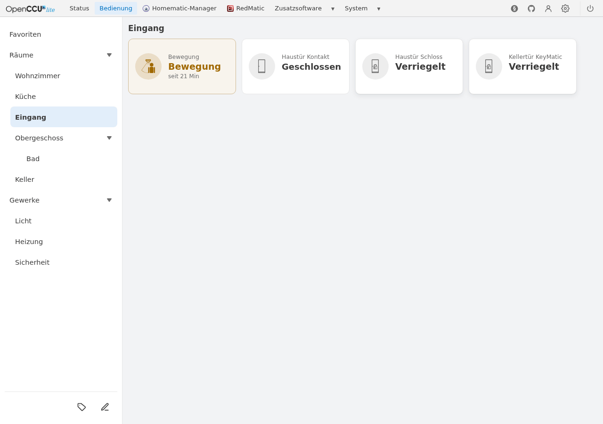</picture>

**Türschlösser** (HmIP-DLD und KeyMatic) zeigen, ob sie verriegelt sind, und schließen auf und zu.

<picture><source media="(prefers-color-scheme: dark)" srcset="67-bedienung-rollladen-dunkel.png">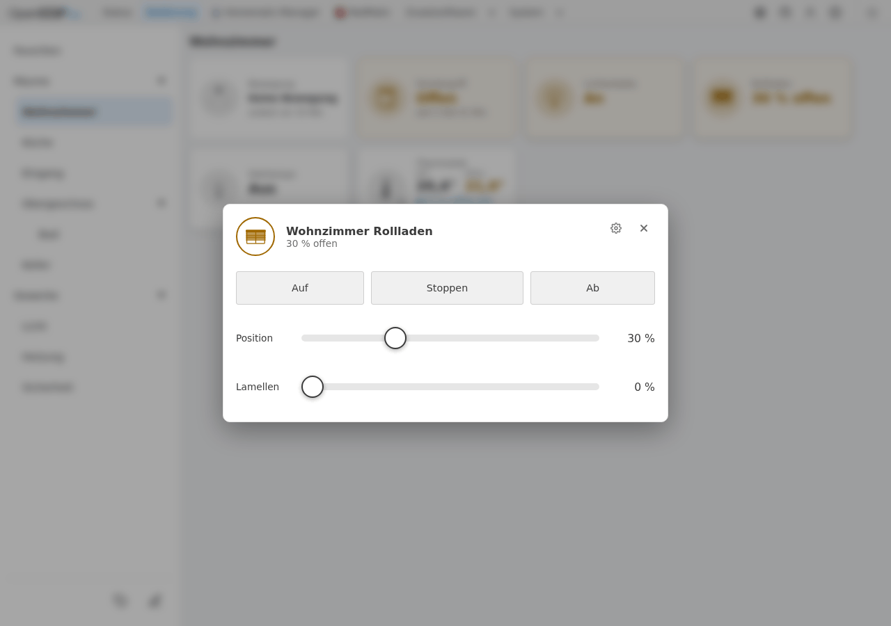</picture>

Die Bedienung eines Rollladens: Auf, Stoppen und Ab, die Position und, bei einer Jalousie, die Lamellen.

<picture><source media="(prefers-color-scheme: dark)" srcset="68-bedienung-heizung-dunkel.png">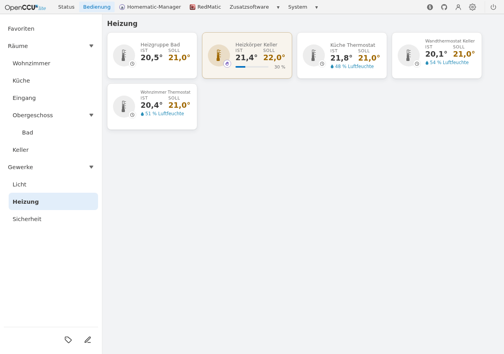</picture>

Ein Gewerk sammelt Kanäle aus allen Räumen, hier die Heizung: eine **Heizgruppe**, ein Heizkörperthermostat mit der
Öffnung seines Ventils und ein Wandthermostat mit der Luftfeuchte.

Auf dem Telefon wird aus dem Baum links eine Schublade hinter einem runden Knopf. Wie Kanäle zu Namen, Räumen und
Gewerken kommen, zeigt der Abschnitt [Namen, Räume und Gewerke](#namen-räume-und-gewerke). Unter Einstellungen lässt
sich die Bedienung zur Startseite machen, ohne Kopfleiste als ganzes Fenster zeigen, aus der Kopfleiste nehmen oder
ohne Anmeldung freigeben.

## Das System-Menü

<picture><source media="(prefers-color-scheme: dark)" srcset="07-systemmenue-dunkel.png">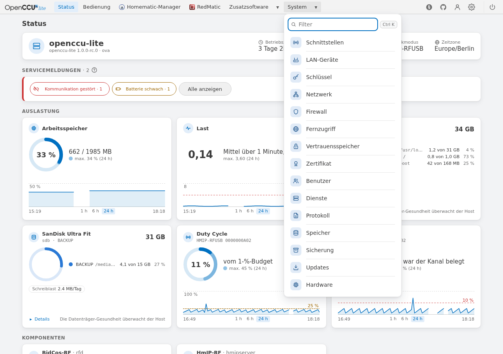</picture>

Alles, was das System selbst betrifft, liegt hinter **System** in der Kopfleiste. Das Menü hat oben ein Filterfeld
(auch mit Strg+K bzw. ⌘+K zu öffnen), das die Seiten nicht nur nach ihrem Namen findet: „ACME“ findet das Zertifikat,
„OIDC“ die Benutzer, „systemd“ die Dienste. Ein Punkt neben einem Eintrag zeigt, dass eine Warnung auf diese Seite
verweist. Jede Seite hat ihre eigene Adresse unter `/system/…` und lässt sich direkt verlinken; die kleinen
Fragezeichen an den Abschnitten erklären, was dort passiert.

### Schnittstellen

<picture><source media="(prefers-color-scheme: dark)" srcset="08-schnittstellen-dunkel.png">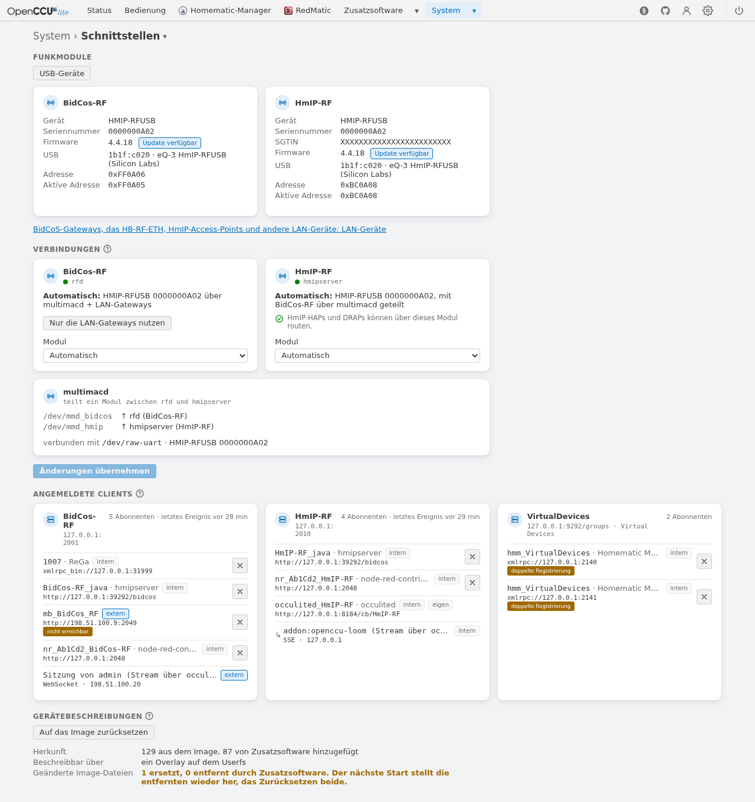</picture>

Die Funktechnik des Systems:

- **Funkmodule:** welches Modul erkannt wurde (RPI-RF-MOD, HmIP-RFUSB, HM-MOD-RPI-PCB …), mit Seriennummer, Firmware,
  Funkadresse und USB-Kennung; „USB-Geräte“ zeigt den ganzen USB-Baum.
- **Verbindungen:** welche Schnittstelle (BidCos-RF, HmIP-RF) über welches Modul funkt, automatisch oder von Hand
  gewählt, ob sich ein Modul über `multimacd` beide Protokolle teilt und ob HmIP-Access-Points über das Modul routen
  können. „Letzte Änderung“ zeigt, wie die letzte Umstellung ausging.
- **Angemeldete Clients:** wer sich bei `rfd` und `hmipserver` für Ereignisse registriert hat (Addons, Node-RED,
  Home Assistant …), ob er erreichbar ist, und doppelte Registrierungen; ein Client lässt sich hier abmelden.
- **Gerätebeschreibungen:** was Addons an Gerätebeschreibungen hinzugefügt oder ersetzt haben, mit dem Weg zurück auf
  den Stand des Images.

### LAN-Geräte

<picture><source media="(prefers-color-scheme: dark)" srcset="09-lan-geraete-dunkel.png">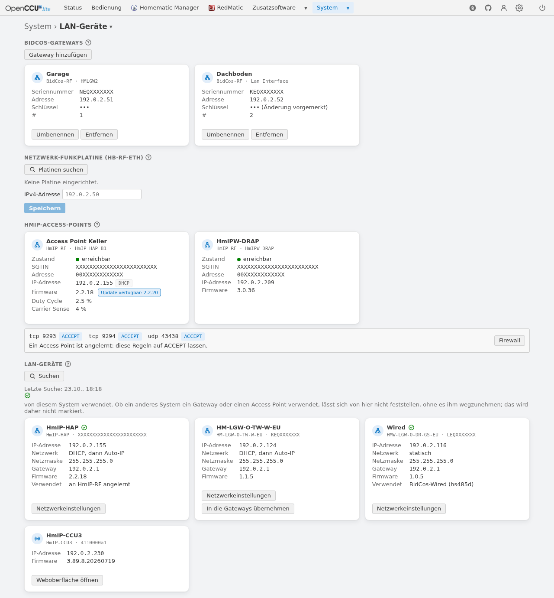</picture>

Alles, worüber das System über das Netzwerk funkt: **BidCoS-Gateways** (HM-LGW, HMW-LGW) mit Hinzufügen, Umbenennen,
Entfernen und ihrem Schlüssel, die Netzwerk-Funkplatine **HB-RF-ETH**, die **HmIP-Access-Points** (HAP, DRAP) mit
Zustand, Firmware und den Firewall-Regeln, die sie brauchen, und eine **Suche** nach eQ-3-Geräten im lokalen Netz.
Gefundene Gateways lassen sich direkt übernehmen und ihre Netzwerkeinstellungen ändern.

### Schlüssel

<picture><source media="(prefers-color-scheme: dark)" srcset="10-schluessel-dunkel.png">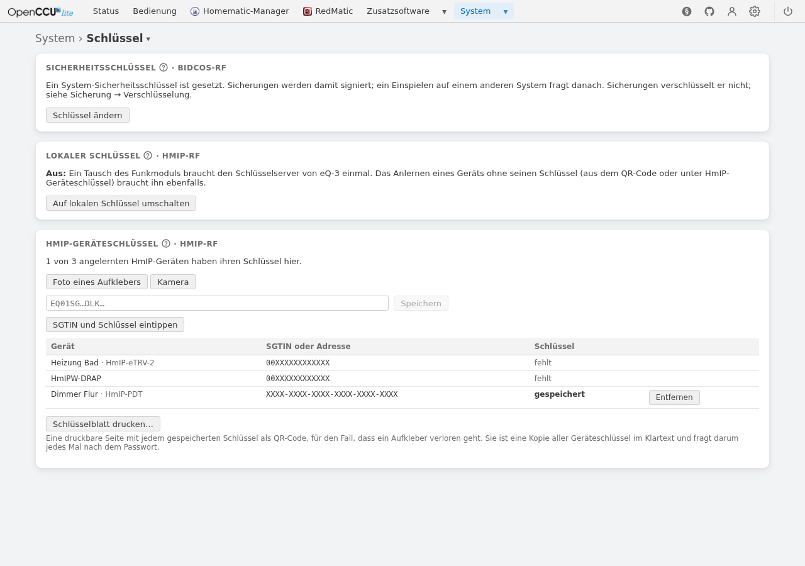</picture>

Die drei Arten von Schlüsseln:

- der **Sicherheitsschlüssel** von BidCos-RF (der „Zentralenschlüssel“), mit dem auch Sicherungen signiert werden;
- der **lokale Schlüssel** von HmIP-RF: damit braucht ein Tausch des Funkmoduls den Schlüsselserver von eQ-3 nicht
  mehr;
- die **HmIP-Geräteschlüssel** aus dem QR-Code auf den Geräten: per Foto eines Aufklebers, mit der Kamera oder
  eingetippt. „Schlüsselblatt drucken“ erzeugt eine Seite mit allen gespeicherten Schlüsseln als QR-Codes, für den
  Fall, dass ein Aufkleber verloren geht.

### Netzwerk

<picture><source media="(prefers-color-scheme: dark)" srcset="11-netzwerk-dunkel.png">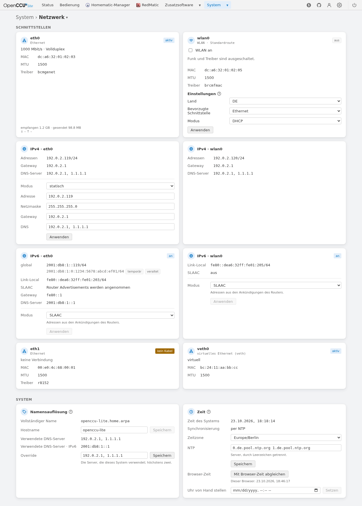</picture>

Jede Netzwerkschnittstelle mit Verbindung, MAC-Adresse und Treiber, darunter IPv4 und IPv6 je Schnittstelle: die
aktuellen Adressen und die Einstellung (DHCP oder statisch; für IPv6 aus, SLAAC, DHCPv6 oder statisch). Ein Raspberry
Pi mit WLAN bekommt hier auch das **WLAN**: Land, bevorzugte Schnittstelle, Netz und Modus. Unten **Namensauflösung**
(Hostname, DNS-Server) und **Zeit** (Zeitzone, NTP-Server, Abgleich mit der Uhr des Browsers oder von Hand).

### Firewall

<picture><source media="(prefers-color-scheme: dark)" srcset="12-firewall-dunkel.png">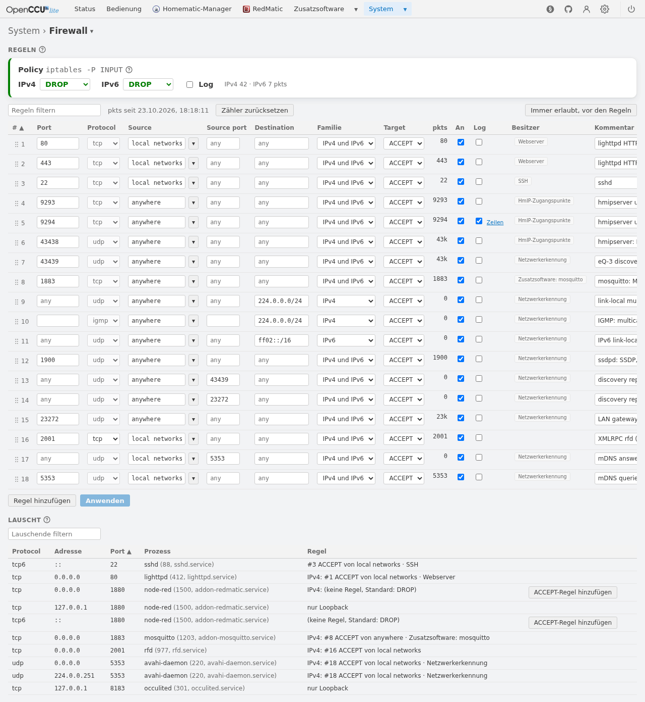</picture>

Die Firewall des Systems als Tabelle von Regeln, so wie `iptables` sie kennt: Port, Protocol, Source, Destination,
Target und je Regel ein Zähler, ob sie greift. Die **Policy** gilt für alles, wofür keine Regel passt. Regeln lassen
sich hinzufügen, ändern, sortieren, protokollieren und abschalten; Regeln, die zu einem Addon, dem Webserver oder den
Access Points gehören, sind mit ihrem **Besitzer** gekennzeichnet. „Immer erlaubt, vor den Regeln“ zeigt, was das
System vor der Tabelle zulässt (etwa Loopback und bestehende Verbindungen). Der Abschnitt **Lauscht** listet jeden
offenen Port mit seinem Prozess und der Regel, die ihn erreicht, und bietet für einen blockierten Port direkt eine
ACCEPT-Regel an. Mehr dazu in [security.md](../security.md).

### Fernzugriff

<picture><source media="(prefers-color-scheme: dark)" srcset="13-fernzugriff-dunkel.png">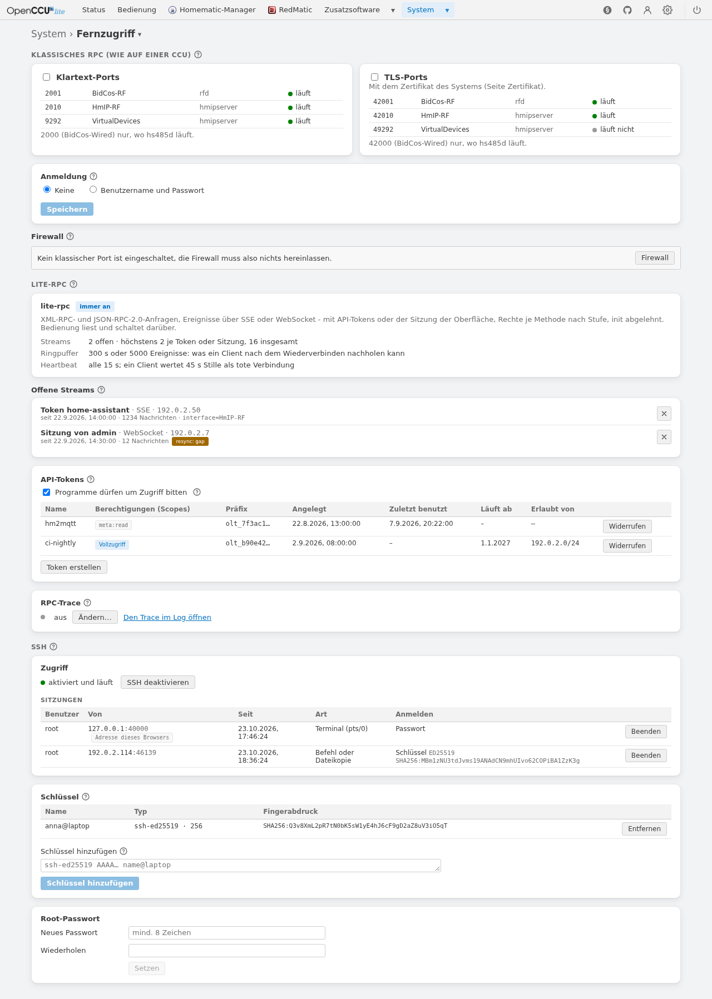</picture>

Alles, womit andere Programme auf das System zugreifen:

- **Klassisches RPC** wie auf einer CCU (Ports 2001, 2010, 9292 und ihre TLS-Varianten) für ioBroker, Home Assistant,
  Node-RED und andere; standardmäßig aus, auf Wunsch mit Benutzername und Passwort. Die Seite zeigt, ob die Firewall
  die eingeschalteten Ports hereinlässt.
- **lite-rpc**, die neue Schnittstelle: XML-RPC und JSON-RPC mit API-Tokens und Ereignissen über SSE oder WebSocket,
  mit den gerade offenen Streams.
- **API-Tokens** für Programme, mit Berechtigungen (Scopes), Ablaufdatum und erlaubten Adressen; auf Wunsch dürfen
  Programme selbst um einen Token bitten, den Sie dann freigeben.
- **RPC-Trace**, der den RPC-Verkehr für eine Weile ins Protokoll schreibt.
- **SSH:** ein- und ausschalten, offene Sitzungen, die Schlüssel für `root` und das Root-Passwort.

### Vertrauensspeicher

<picture><source media="(prefers-color-scheme: dark)" srcset="14-vertrauensspeicher-dunkel.png">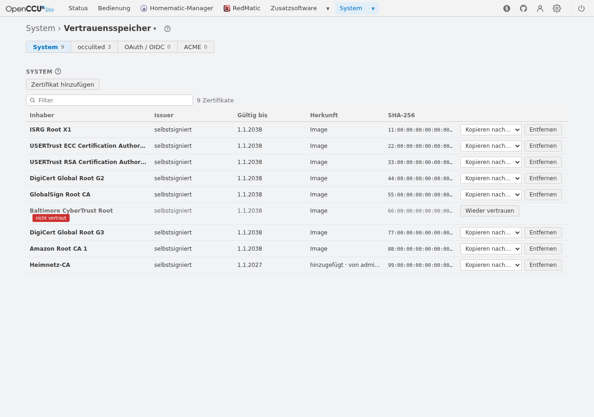</picture>

Die Zertifizierungsstellen, denen das System vertraut, getrennt nach Verwendung: das System selbst, occulited, die
Anmeldung über OAuth/OpenID Connect und ACME. Eine eigene CA (etwa die des Heimnetzes) lässt sich hinzufügen, eine
mitgelieferte auf „nicht vertraut“ setzen und wieder zurückholen, und ein Eintrag in einen anderen Speicher kopieren.

### Zertifikat

<picture><source media="(prefers-color-scheme: dark)" srcset="15-zertifikat-dunkel.png">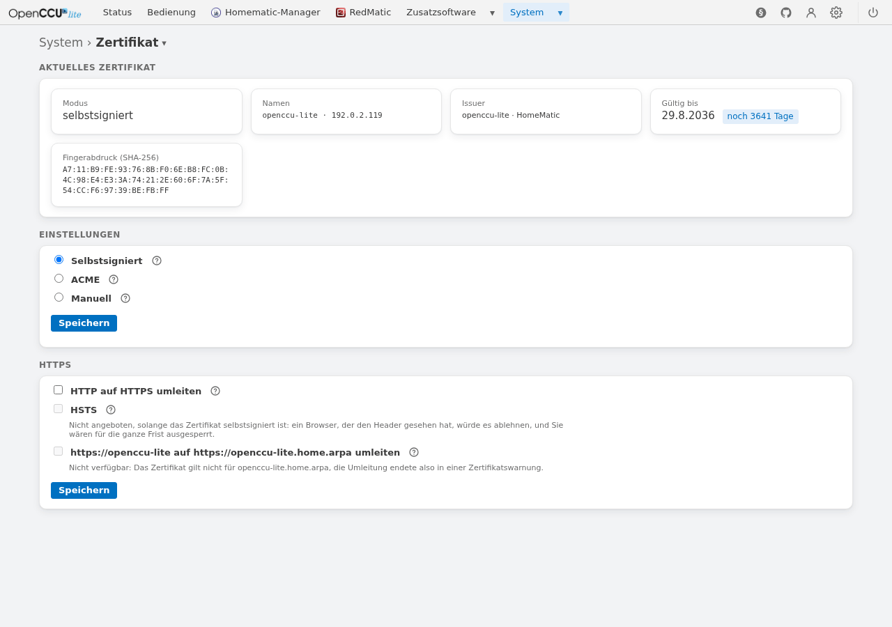</picture>

Das Zertifikat, mit dem die Weboberfläche über HTTPS erreichbar ist: **selbstsigniert** (der Ausgangszustand),
per **ACME** von Let's Encrypt oder einer eigenen CA (HTTP- oder DNS-Challenge, mehrere DNS-Anbieter) oder **manuell**
hochgeladen. Darunter die HTTPS-Einstellungen: HTTP auf HTTPS umleiten, HSTS (erst mit einem nicht selbstsignierten
Zertifikat) und die Umleitung vom kurzen Namen auf den vollständigen. Details in [tls-acme.md](../tls-acme.md).

#### Mit ACME

<picture><source media="(prefers-color-scheme: dark)" srcset="16-zertifikat-acme-dunkel.png">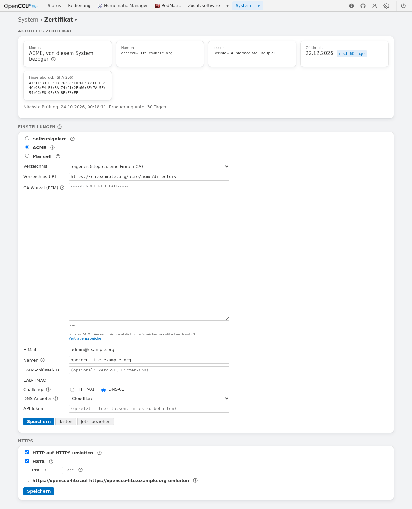</picture>

So sieht die Seite aus, wenn das System sein Zertifikat per ACME bezieht, hier von einer eigenen CA
(`https://ca.example.org/acme/acme/directory`) für den Namen `openccu-lite.example.org`. Sie geben das Verzeichnis
(Let's Encrypt, ZeroSSL oder eine eigene CA mit ihrem Stammzertifikat), eine E-Mail-Adresse, die Namen, wo nötig die
EAB-Zugangsdaten und die Challenge an: HTTP-01, oder DNS-01 über einen der DNS-Anbieter mit seinem API-Token. „Testen“
spielt den ganzen Ablauf gegen das Staging-Verzeichnis durch, ohne etwas zu installieren; „Jetzt beziehen“ holt das
Zertifikat, danach verlängert das System es selbst, wenn es weniger als 30 Tage gilt. Mit einem solchen Zertifikat
lassen sich auch HSTS (mit seiner Frist) und die Umleitung auf den vollständigen Namen einschalten.

### Benutzer

<picture><source media="(prefers-color-scheme: dark)" srcset="17-benutzer-dunkel.png">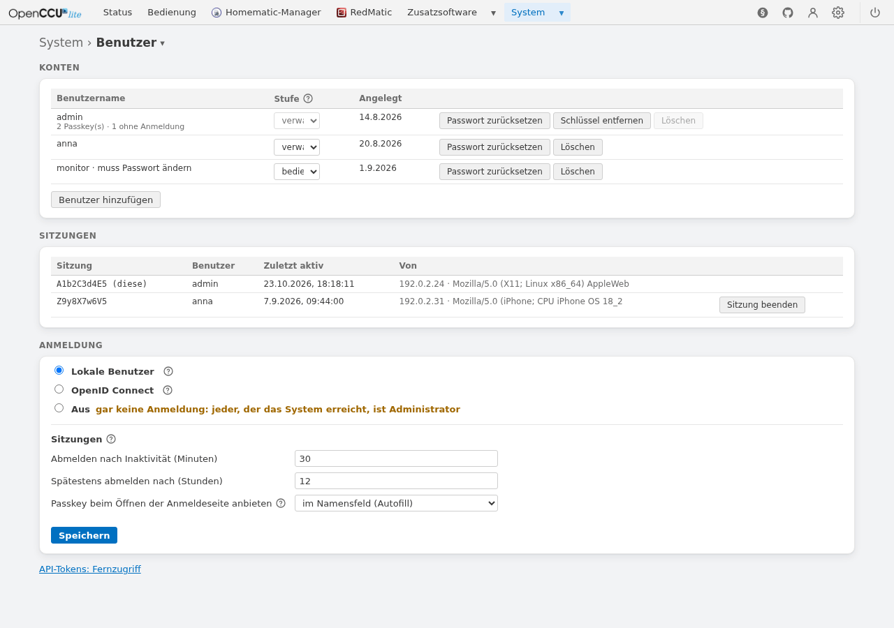</picture>

Die Benutzerkonten mit ihrer **Stufe**: *lesen* (sieht alles, ändert nichts), *bedienen* (schaltet und setzt Werte),
*konfigurieren* (auch Namen, Räume, Gewerke und Favoriten) und *verwalten* (alles, auch die Systemseiten). Passwörter
lassen sich zurücksetzen, die Passkeys eines Kontos entfernen, und die offenen **Sitzungen** aller Benutzer einsehen
und beenden. Unter **Anmeldung** wählen Sie zwischen lokalen Benutzern und OpenID Connect (Single Sign-on über einen
eigenen Anbieter); „Aus“ schaltet jede Anmeldung ab, dann ist jeder, der das System erreicht, Administrator. Darunter
die Länge der **Sitzungen** (Abmelden nach Inaktivität, spätestens nach einigen Stunden) und ob die Anmeldeseite einen
Passkey gleich anbietet.

#### OpenID Connect

<picture><source media="(prefers-color-scheme: dark)" srcset="18-benutzer-oidc-dunkel.png">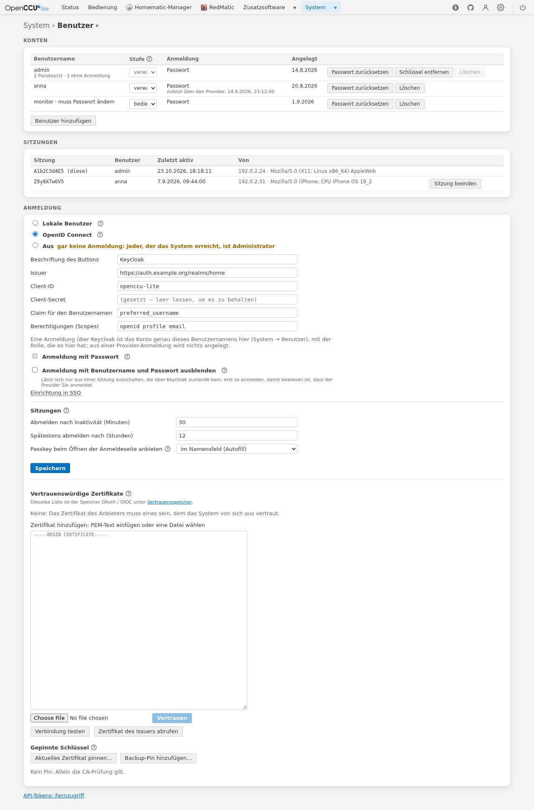</picture>

Mit **OpenID Connect** melden sich Benutzer über einen eigenen Anbieter an, etwa Keycloak oder Authentik; im Bild ein
Beispiel-Keycloak unter `https://auth.example.org/realms/home`. Sie tragen die Beschriftung des Buttons, den Issuer,
Client-ID und Client-Secret, den Claim für den Benutzernamen und die Scopes ein; „Verbindung testen“ prüft die
Einstellungen gegen den Anbieter. Eine Anmeldung über den Anbieter gehört zum Konto mit genau diesem Benutzernamen und
bekommt dessen Stufe; ein neues Konto legt sie nicht an. Die Anmeldung mit Passwort lässt sich ausblenden, aber nur aus
einer Sitzung, die über den Anbieter zustande kam. Vertraut das System dem Zertifikat des Anbieters nicht von sich aus,
lässt sich dessen CA hier (oder unter Vertrauensspeicher → OAuth / OIDC) hinzufügen; unter **Gepinnte Schlüssel**
lässt sich das System zusätzlich auf den Schlüssel des Anbieters festlegen.

<picture><source media="(prefers-color-scheme: dark)" srcset="19-anmeldung-oidc-dunkel.png">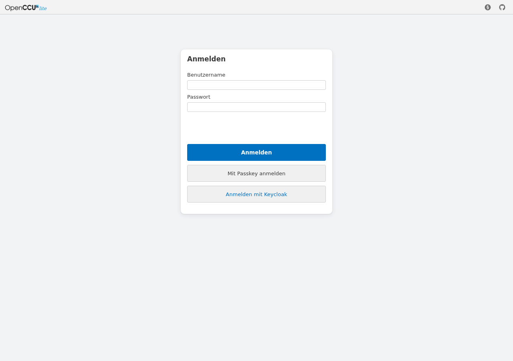</picture>

Die Anmeldeseite bietet dann zusätzlich den Button des Anbieters an.

### Dienste

<picture><source media="(prefers-color-scheme: dark)" srcset="20-dienste-dunkel.png">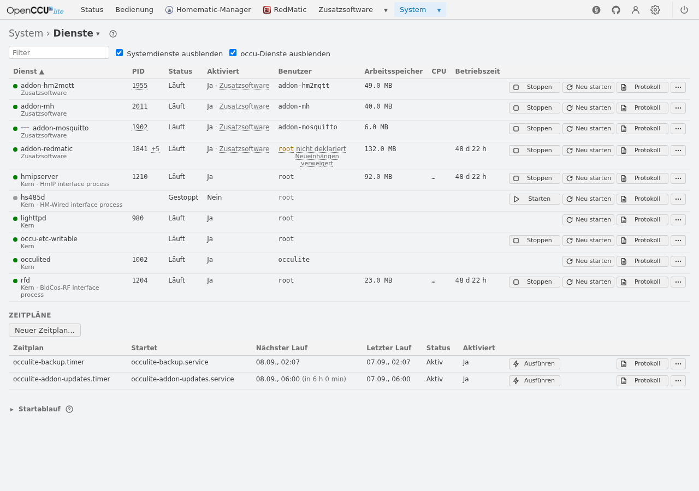</picture>

Die systemd-Dienste des Systems mit Status, Benutzer, Speicher- und CPU-Verbrauch und Betriebszeit: die Funkdienste
(`rfd`, `hmipserver`, `hs485d`), der Webserver, occulited und jede Zusatzsoftware. Dienste lassen sich starten,
stoppen, neu starten und ihr Protokoll öffnen; das Menü „…“ bietet mehr, etwa die Unit-Datei. Bei einem Addon zeigt die
Spalte Benutzer, ob es eingesperrt unter einem eigenen Benutzer läuft oder als `root`. Darunter die **Zeitpläne**
(systemd-Timer, auch eigene) und der **Startablauf** des letzten Systemstarts.

#### Startablauf

<picture><source media="(prefers-color-scheme: dark)" srcset="44-startablauf-dunkel.png">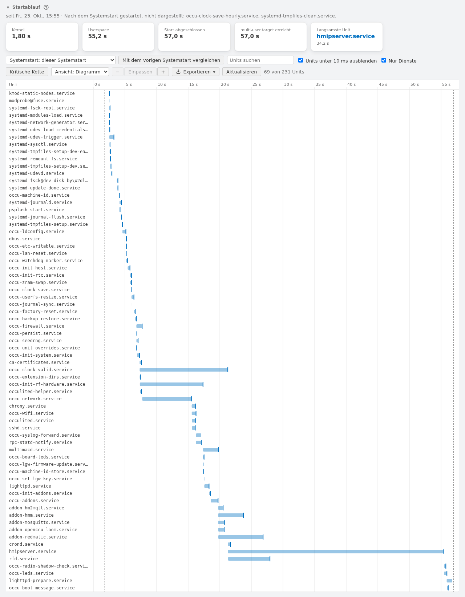</picture>

Der Startablauf zeigt, wann beim Systemstart welcher Dienst gestartet wurde (Beginn des Balkens) und wann er bereit
war (Ende des Balkens), auf einer Zeitachse ab dem Einschalten; oben die Dauer von Kernel und Userspace und die
langsamste Unit. Sie können einen früheren Systemstart wählen, mit dem vorigen vergleichen, nach Units suchen, die
kritische Kette anzeigen und das Diagramm exportieren. Das Bild stammt von einem echten System, einem Raspberry Pi 4:
Die Zusatzsoftware (`addon-hm2mqtt`, `addon-hmm`, `addon-mosquitto`, `addon-openccu-loom`, `addon-redmatic`) startet
nach etwa 20 Sekunden, **vor** `rfd` und `hmipserver`, und `hmipserver` ist erst nach gut 55 Sekunden bereit. Das ist
der **frühe Start der Zusatzsoftware** (Zusatzsoftware → Start der Zusatzsoftware): Addons, die damit umgehen können,
dass die Funk-Schnittstellen noch nicht bereit sind, starten vor ihnen und verbinden sich, sobald die Schnittstellen da
sind. So sind etwa Node-RED oder der Homematic Manager schon erreichbar, während `hmipserver` noch lädt, und das System
ist insgesamt früher nutzbar.

### Protokoll

<picture><source media="(prefers-color-scheme: dark)" srcset="21-protokoll-dunkel.png">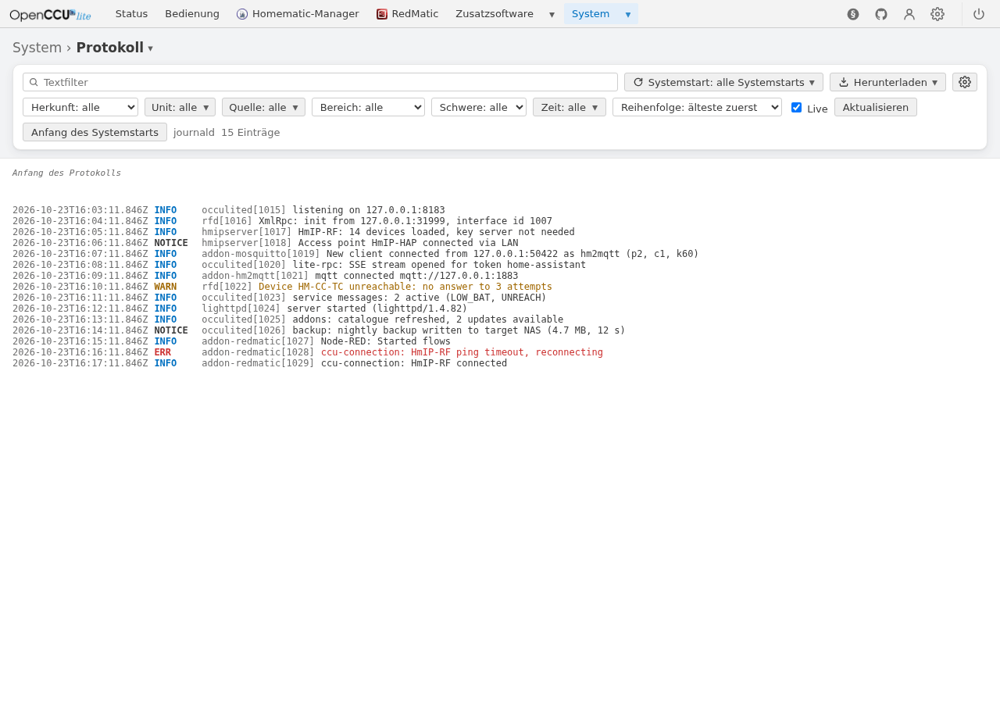</picture>

Das Systemprotokoll (Journal) mit Filtern nach Text, Herkunft, Unit, Quelle, Bereich, Schwere und Zeit, live oder
von einem früheren Systemstart, und zum Herunterladen; beim Scrollen lädt die Seite das ganze Protokoll seit dem Start
nach. Das Zahnrad öffnet die Einstellungen: die Protokollstufen der Funkdienste und von occulited, wo und wie lange das
Journal gespeichert wird und wo der Verlauf der Messwerte liegt.

#### Protokoll-Einstellungen

<picture><source media="(prefers-color-scheme: dark)" srcset="46-protokoll-stufen-dunkel.png">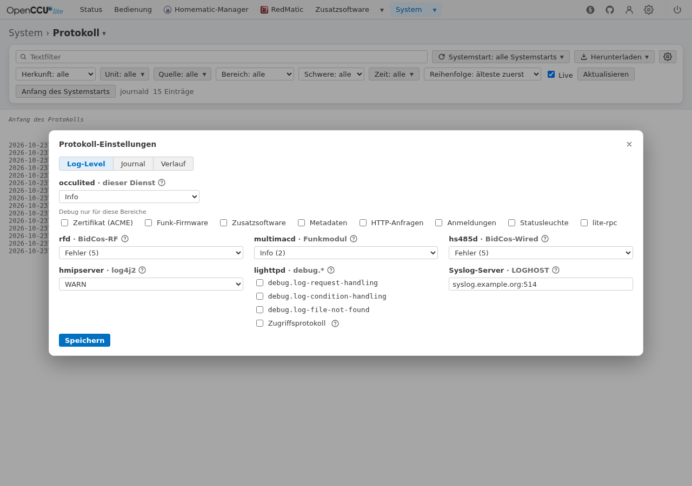</picture>

**Log-Level:** wie ausführlich occulited protokolliert (auf Wunsch mit Debug-Ausgaben nur für einzelne Bereiche wie
ACME, Funk-Firmware oder lite-rpc), die Stufen von `rfd`, `multimacd`, `hs485d` und `hmipserver` sowie die
Debug-Schalter und das Zugriffsprotokoll von `lighttpd`. **Syslog-Server** schickt das Protokoll zusätzlich an einen
Syslog-Server im Netz (`host` oder `host:port`), etwa an eine zentrale Protokollsammlung.

<picture><source media="(prefers-color-scheme: dark)" srcset="47-protokoll-journal-dunkel.png">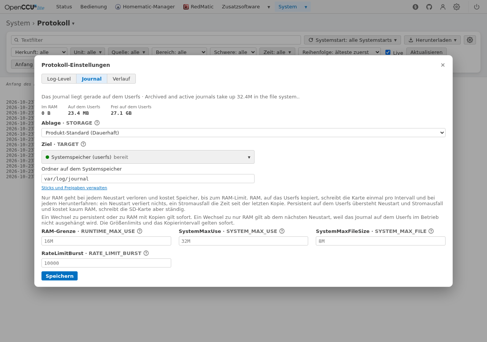</picture>

**Journal:** wo das Systemprotokoll liegt. Die **Ablage** hat drei Stufen:

- **Nur RAM:** geht bei jedem Neustart verloren, schont aber den Speicher vollständig. Für Systeme, bei denen das
  Protokoll nach einem Neustart nicht gebraucht wird.
- **RAM, auf das Userfs kopiert** (ram-sync): das Journal liegt im RAM und wird in einem festen Intervall und bei jedem
  Herunterfahren kopiert. Ein Neustart verliert nichts, ein Stromausfall höchstens die Zeit seit der letzten Kopie. Die
  schonende Wahl für einen Raspberry Pi mit **SD-Karte**, die nur einmal pro Intervall beschrieben wird.
- **Persistent auf dem Userfs:** übersteht Neustart und Stromausfall und braucht kaum RAM, schreibt aber ständig. Das
  passt zu einer **VM (OVA)** oder einer SSD, wo das nicht schadet; auf der VM ist es die Voreinstellung.

Dazu die Größengrenzen (RAM-Grenze, SystemMaxUse, SystemMaxFileSize) und die Rate-Begrenzung, jeweils mit den Namen der
journald-Optionen.

<picture><source media="(prefers-color-scheme: dark)" srcset="48-protokoll-ziel-dunkel.png">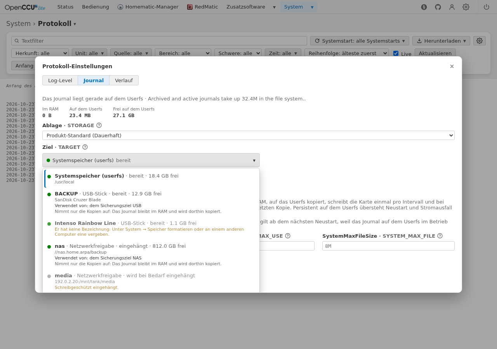</picture>

Als **Ziel** der Kopien kommt statt des Systemspeichers auch ein **USB-Stick** oder eine **Netzwerkfreigabe** in
Frage (unter System → Speicher eingerichtet). Das Journal bleibt dann im RAM und wird dorthin kopiert: So wird die
SD-Karte gar nicht beschrieben, und das Protokoll überlebt auch den Tausch der Karte. Die Liste zeigt je Ziel, ob es
bereit ist, wie viel Platz frei ist und wofür es schon verwendet wird.

<picture><source media="(prefers-color-scheme: dark)" srcset="49-protokoll-verlauf-dunkel.png">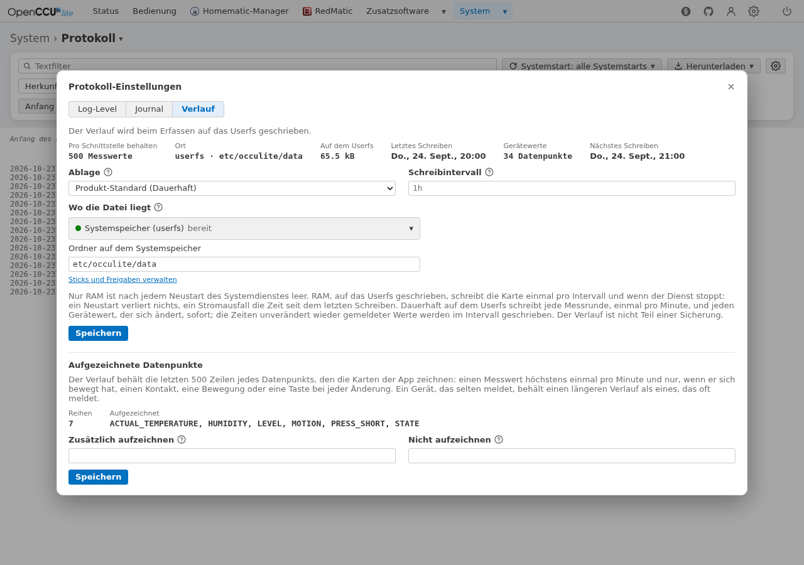</picture>

**Verlauf:** die Messwerte, aus denen die Statusseite und die Bedienung ihre Verläufe zeichnen (Auslastung, Duty Cycle,
Temperaturen, Bewegungen …). Wie das Journal kann der Verlauf nur im RAM liegen, in einem Intervall auf das Userfs
kopiert oder dauerhaft dort geschrieben werden, auch auf einem USB-Stick oder einer Freigabe. Darunter, welche
Datenpunkte der Geräte aufgezeichnet werden, mit der Möglichkeit, weitere hinzuzunehmen oder einzelne auszuschließen.

### Speicher

<picture><source media="(prefers-color-scheme: dark)" srcset="22-speicher-dunkel.png">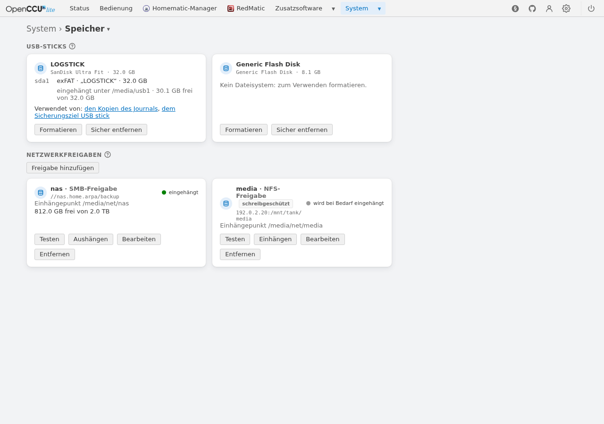</picture>

Angesteckte **USB-Sticks** (formatieren, sicher entfernen, und wofür sie gerade verwendet werden) und
**Netzwerkfreigaben** (SMB oder NFS), die das System einhängt, etwa als Ziel für Sicherungen, die Kopien des Journals
oder den Verlauf.

### Sicherung

<picture><source media="(prefers-color-scheme: dark)" srcset="23-sicherung-dunkel.png">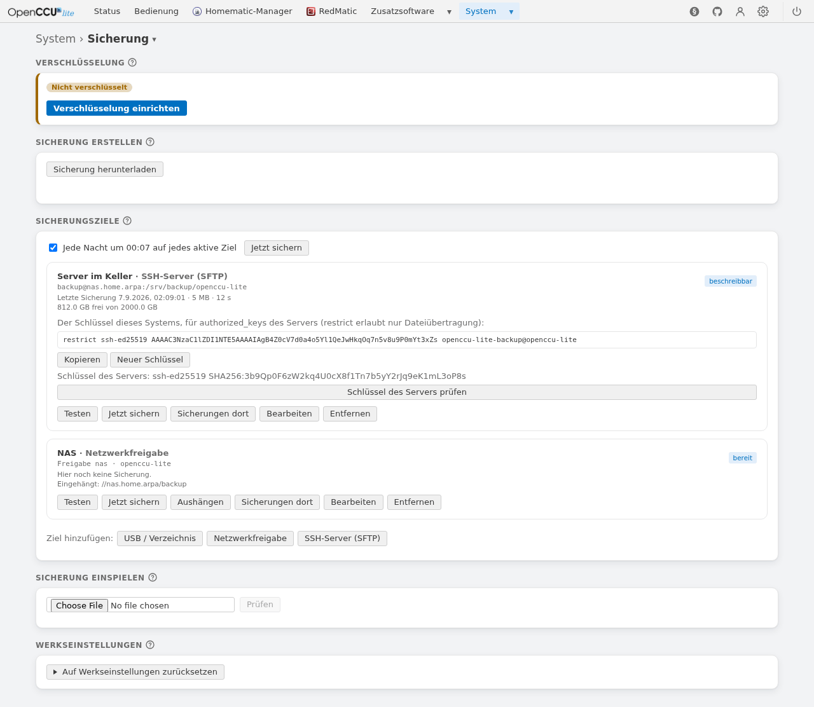</picture>

- **Verschlüsselung:** mit einem Wiederherstellungsschlüssel werden Sicherungen verschlüsselt; ohne ihn enthält eine
  Sicherung jeden Schlüssel des Systems im Klartext.
- **Sicherung erstellen:** eine Sicherung sofort herunterladen.
- **Sicherungsziele:** jede Nacht automatisch auf ein USB-Verzeichnis, eine Netzwerkfreigabe oder einen SSH-Server
  (SFTP), mit Test, „Jetzt sichern“ und der Liste der Sicherungen dort. Von einem Server oder NAS aus holt
  [occulite-backup](https://github.com/hobbyquaker/occulite-backup) die Sicherung mit einem API-Token ab.
- **Sicherung einspielen:** eine Sicherung prüfen und wiederherstellen, auch die einer CCU oder von OpenCCU. Aus einer
  geprüften Sicherung einer CCU oder von OpenCCU lassen sich auch nur die angelernten Geräte mit ihren Schlüsseln
  übernehmen, ohne den Rest wiederherzustellen; nur auf einem System ohne angelernte Geräte. Eine Aktion übernimmt
  alles: zuerst die Namen, Räume und Gewerke der ReGa-Datenbank der Sicherung, dann die Geräte mit ihren Schlüsseln,
  dann der Neustart. Vorher sagt die Seite, wenn die HmIP-Identität der Sicherung zu einem anderen Funkmodul gehört
  (hmipserver übernimmt sie beim Start auf das Modul dieses Systems; die Seite Schnittstellen zeigt danach, wie es
  ausging) und wenn die Sicherung einen eigenen BidCos-Sicherheitsschlüssel hat (er kommt so mit).
- **Werkseinstellungen:** alles löschen und neu mit der Einrichtungsseite beginnen.

### Updates

<picture><source media="(prefers-color-scheme: dark)" srcset="24-updates-dunkel.png">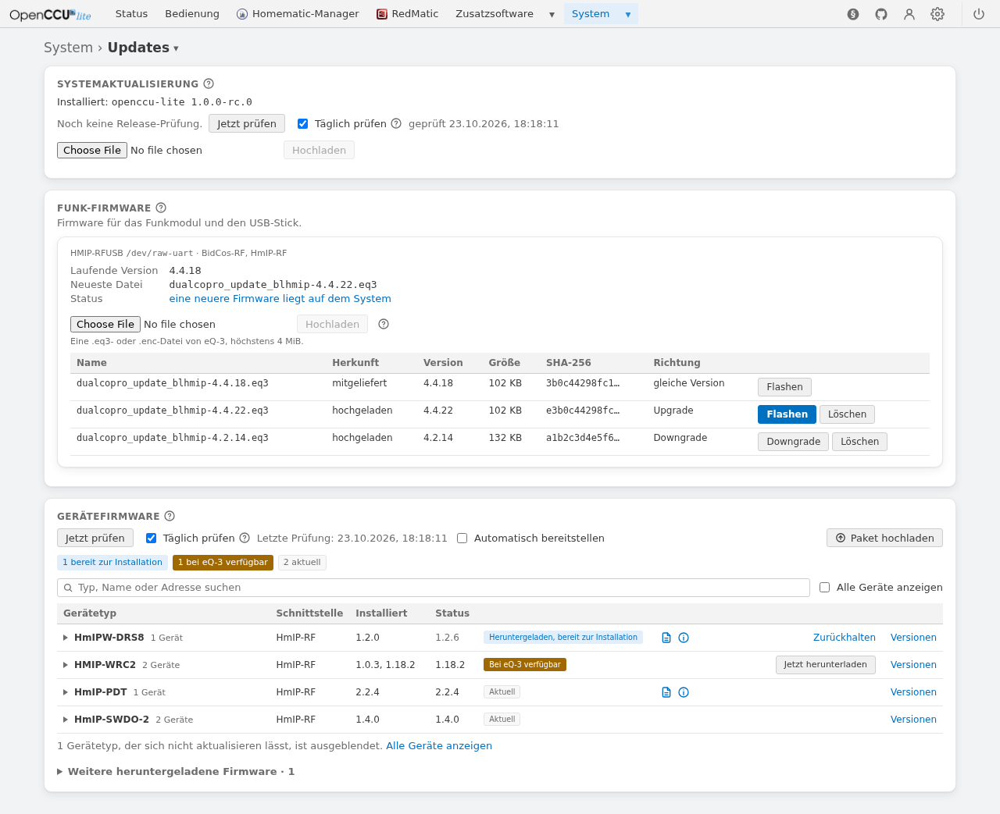</picture>

- **Systemaktualisierung:** die installierte Version, die Prüfung auf ein neues Release (auf Wunsch täglich), die
  Versionshinweise einer neuen Version und das Hochladen eines Update-Pakets.
- **Funk-Firmware:** die Firmware des Funkmoduls, mitgelieferte und hochgeladene Versionen, Flashen, Upgrade und
  Downgrade.
- **Gerätefirmware:** die angelernten Gerätetypen mit der installierten Firmware und der neuesten Version bei eQ-3, je
  Typ alle verfügbaren Versionen, Hinweise und Änderungsprotokoll der Firmware, und das Hochladen eigener
  Firmware-Pakete. Eine heruntergeladene Firmware erreicht die Geräte erst, wenn Sie sie bereitstellen (oder
  automatisch, wenn „Automatisch bereitstellen“ an ist); „Zurückhalten“ hält sie zurück.

### Hardware

<picture><source media="(prefers-color-scheme: dark)" srcset="25-hardware-dunkel.png">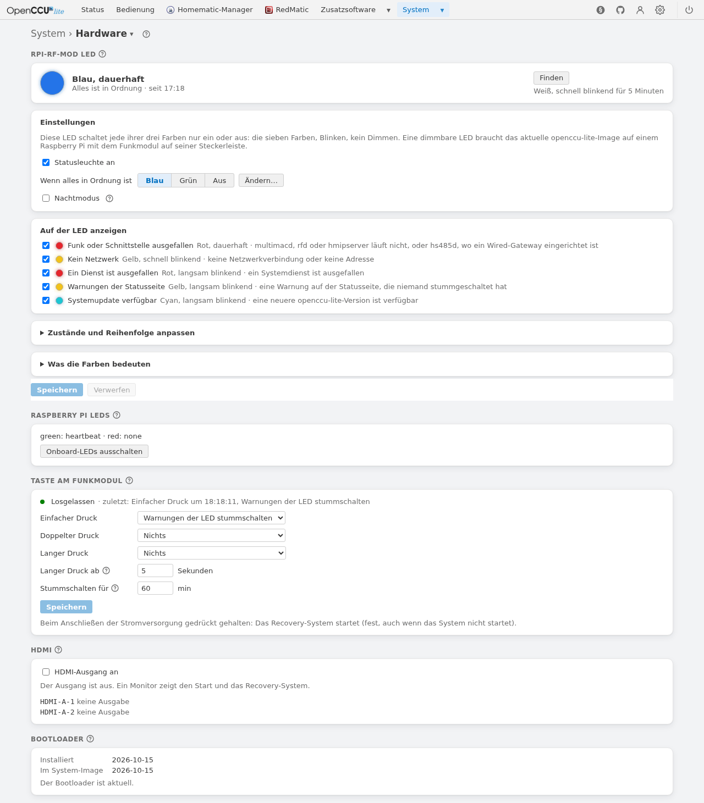</picture>

Die Seite Hardware fasst zusammen, was sich an der Hardware des Systems schalten lässt; ein Abschnitt erscheint nur,
wo das System den Teil hat.

- Die **Statusleuchte** des Funkmoduls (RPI-RF-MOD) zeigt den Zustand des Systems in Farben: blau oder grün, wenn alles
  in Ordnung ist, rot, gelb oder cyan für ausgefallene Dienste, fehlendes Netzwerk, Warnungen oder ein verfügbares
  Update. Welche Zustände sie zeigt und in welcher Reihenfolge lässt sich hier einstellen, dazu ein Nachtmodus, in dem
  sie zu festen Zeiten nur Fehler oder gar nichts zeigt; „Finden“ lässt sie ein paar Minuten weiß blinken, um das Gerät
  zu finden.
- Die **LEDs auf der Platine** des Raspberry Pi.
- Die **Taste am Funkmodul** RPI-RF-MOD auf der Stiftleiste: Einfacher, doppelter und langer Druck lösen je eine
  einstellbare Aktion aus (die Warnungen der LED stummschalten, Finden, für den langen Druck auch ein Neustart oder ein
  Neustart ins Recovery-System); ab Werk schaltet ein einfacher Druck die Warnungen stumm. Beim Anschließen der
  Stromversorgung gedrückt gehalten startet die Taste wie bisher das Recovery-System, auch wenn das System selbst nicht
  mehr startet. Über einen Funkadapter (HB-RF-USB, HB-RF-USB-2, HB-RF-ETH) erreicht die Taste das System nicht.
- Der **HDMI-Ausgang** des Raspberry Pi: standardmäßig aus, abgeschaltet erst, wenn das System gestartet ist, so dass
  ein Monitor den Start und das Recovery-System weiter zeigt.
- Der **Bootloader** im EEPROM des Raspberry Pi 4 und 5: die installierte Version und die im System-Image. Das System
  aktualisiert ihn nie von selbst; eine neuere Version, die mit einem System-Update kommt, wird hier angeboten.

## Beispiele für Funk-Konfigurationen

Wie Schnittstellen und LAN-Geräte bei einer bestimmten Hardware aussehen, zeigen diese Bilder von echten Systemen mit
`1.0.0-rc.0`. Seriennummern, SGTINs, Funkadressen, MAC- und IP-Adressen sind unkenntlich gemacht.

### HmIP-RFUSB mit einem HmIP-Access-Point

<picture><source media="(prefers-color-scheme: dark)" srcset="51-funk-rfusb-schnittstellen-dunkel.png">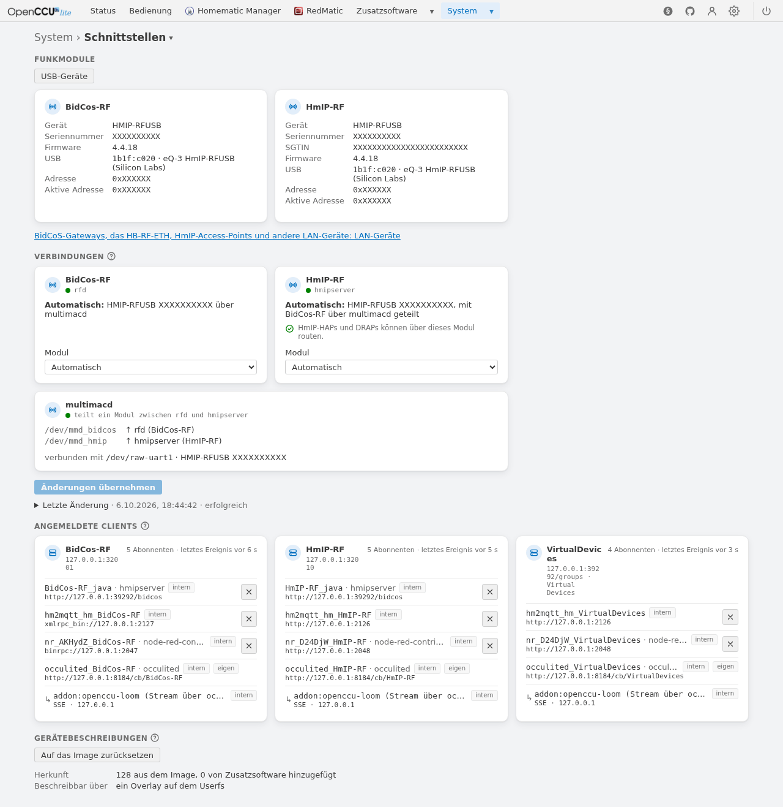</picture>

Ein Raspberry Pi 4 mit dem USB-Funkstick **HmIP-RFUSB**: Er funkt BidCos-RF und HmIP-RF zugleich, `multimacd` teilt
ihn zwischen `rfd` und `hmipserver`. Das ist die einfachste Konfiguration, ohne Funkmodul auf der Platine; sie passt
auch zu einer VM, an die der Stick durchgereicht wird.

<picture><source media="(prefers-color-scheme: dark)" srcset="52-funk-rfusb-lan-geraete-dunkel.png">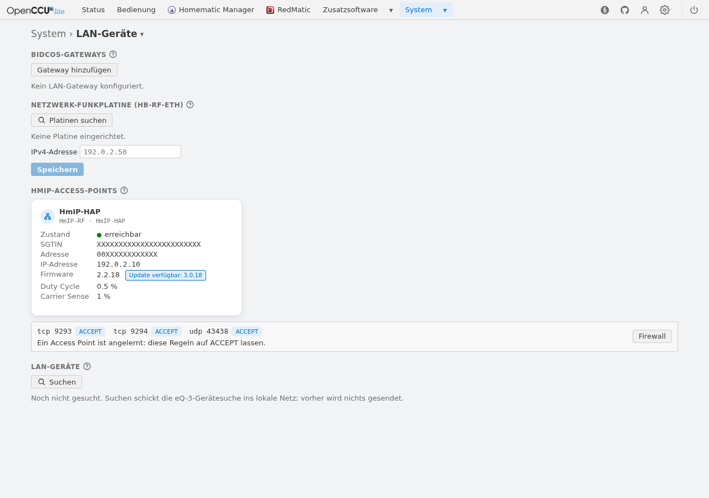</picture>

Dazu ist ein **HmIP-Access-Point** (HAP) angelernt, der die Reichweite von HmIP-RF über das Netzwerk in einen anderen
Gebäudeteil verlängert. Die Seite zeigt seinen Zustand, seine Firmware (hier mit einem verfügbaren Update), Duty Cycle
und Carrier Sense und die Firewall-Regeln, die er braucht.

### Zwei USB-Sticks: HM-CFG-USB-2 und HmIP-RFUSB-TK

<picture><source media="(prefers-color-scheme: dark)" srcset="61-funk-usb-sticks-schnittstellen-dunkel.png">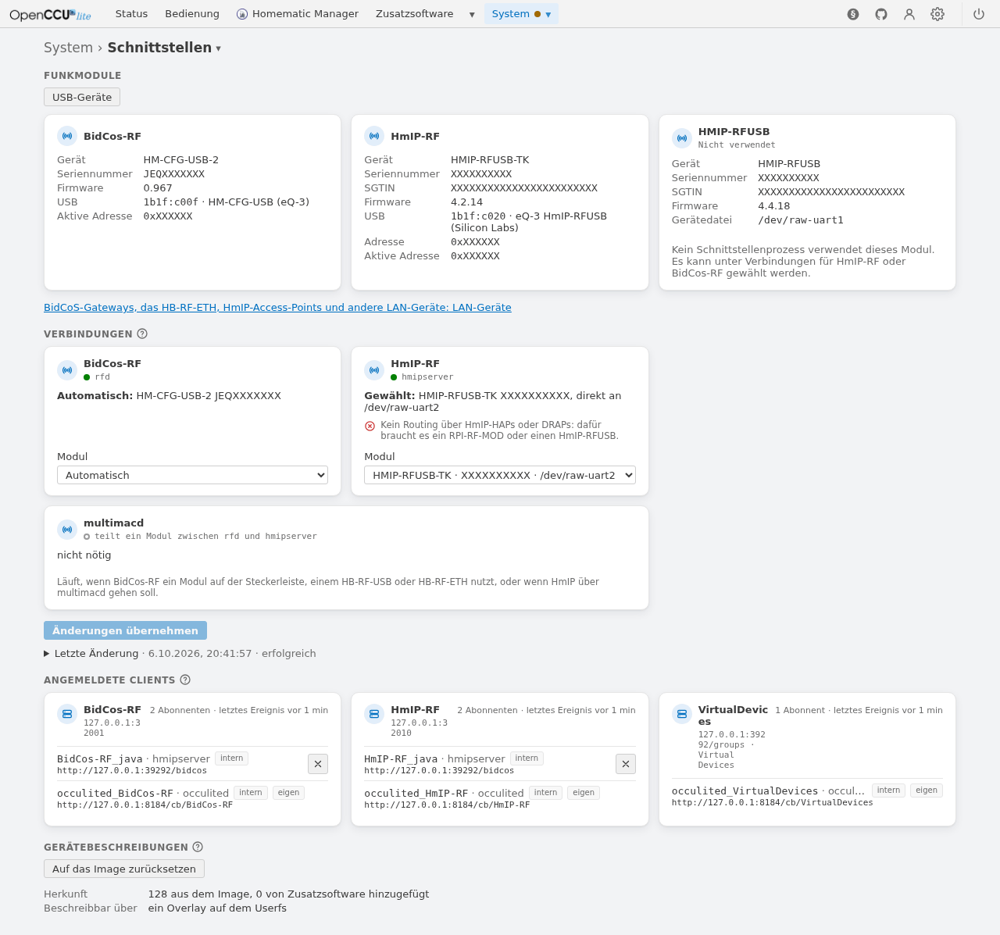</picture>

Ein Raspberry Pi mit getrennten Sticks: der ältere **HM-CFG-USB-2** funkt BidCos-RF, ein **HmIP-RFUSB-TK** HmIP-RF,
von Hand gewählt und direkt angebunden. Jede Schnittstelle hat ihr eigenes Modul, `multimacd` ist nicht nötig. So lässt
sich ein vorhandener BidCos-Stick weiter nutzen; HmIP-Access-Points können über diese Kombination allerdings nicht
routen, das sagt die Seite gleich dazu. Ein dritter Stick, ein HmIP-RFUSB, steckt ebenfalls und wird als „Nicht
verwendet“ angezeigt: Er ließe sich unter Verbindungen für eine der Schnittstellen wählen.

### RPI-RF-MOD mit LAN-Gateways und Wired

<picture><source media="(prefers-color-scheme: dark)" srcset="63-funk-lan-gateways-schnittstellen-dunkel.png">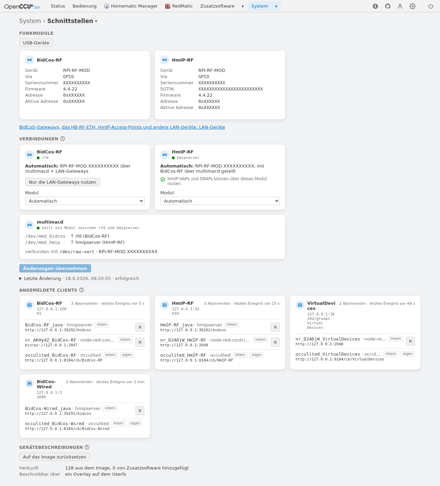</picture>

Ein Raspberry Pi mit dem Funkmodul **RPI-RF-MOD** auf der Steckerleiste (GPIO), das beide Funkprotokolle bedient, dazu
Homematic Wired: Die Schnittstelle BidCos-Wired mit `hs485d` erscheint unter den angemeldeten Clients. BidCos-RF funkt
über das Modul und die LAN-Gateways; „Nur die LAN-Gateways nutzen“ ließe das Modul für BidCos-RF aus.

<picture><source media="(prefers-color-scheme: dark)" srcset="64-funk-lan-gateways-lan-geraete-dunkel.png">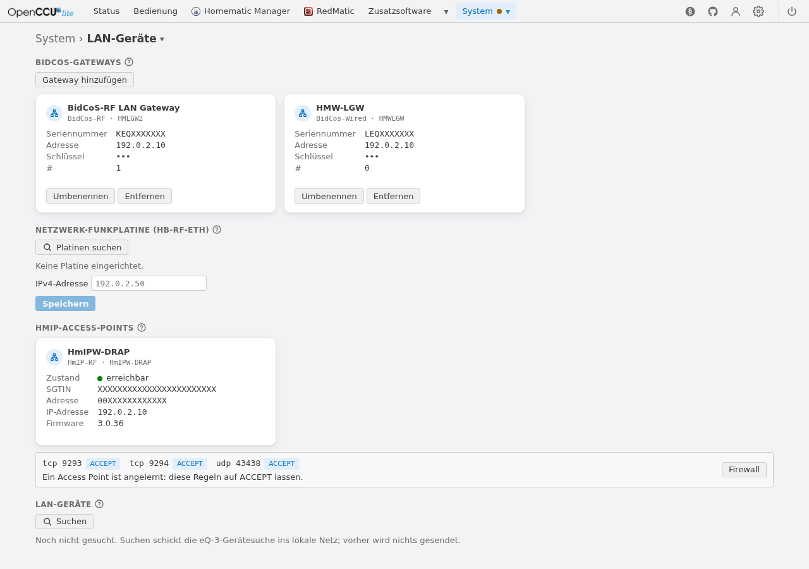</picture>

Ein **HM-LGW** (BidCos-RF LAN Gateway) erweitert die BidCos-Funkreichweite über das Netzwerk, ein **HMW-LGW** bindet
den Wired-Bus an, und ein **HmIPW-DRAP** dient als Access Point für HmIP. Das ist die Konfiguration für größere
Installationen mit mehreren Gebäudeteilen oder einem Wired-Bus aus einer älteren Anlage.

Eine **HB-RF-ETH** (ein Funkmodul wie das HM-MOD-RPI-PCB auf einer Platine mit Netzwerkanschluss) richten Sie unter
LAN-Geräte ein; das System erreicht ihr Modul dann über das Netzwerk, und `multimacd` teilt es zwischen BidCos-RF und
HmIP-RF. Das passt, wenn das System als VM im Keller läuft, das Funkmodul aber an einer günstigen Stelle im Haus stehen
soll.

## Einstellungen, Konto, Lizenzen, Ausschalten

Die Symbole rechts in der Kopfleiste.

### Einstellungen

<picture><source media="(prefers-color-scheme: dark)" srcset="26-einstellungen-dunkel.png">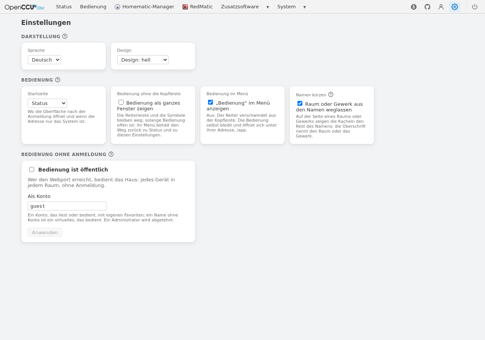</picture>

Sprache und Design (hell, dunkel oder wie das Betriebssystem es vorgibt), die Startseite nach der Anmeldung (Status oder
Bedienung), ob die Bedienung als ganzes Fenster ohne Kopfleiste erscheint, ob ihr Reiter in der Kopfleiste steht
(ausgeblendet bleibt sie unter ihrer Adresse `/app` erreichbar, und die Startseite ist dann Status) und ob die Kacheln
eines Raums oder Gewerks den Raum oder das Gewerk aus ihrem Namen weglassen (aus „Wohnzimmer Stehlampe“ wird im
Wohnzimmer „Stehlampe“). **Bedienung ohne Anmeldung** gibt die Bedienung für jeden frei, der die Weboberfläche
erreicht, unter einem Konto mit höchstens der Stufe *bedienen*; das ist nur für ein abgeschottetes Heimnetz gedacht.

### Konto

<picture><source media="(prefers-color-scheme: dark)" srcset="27-konto-dunkel.png">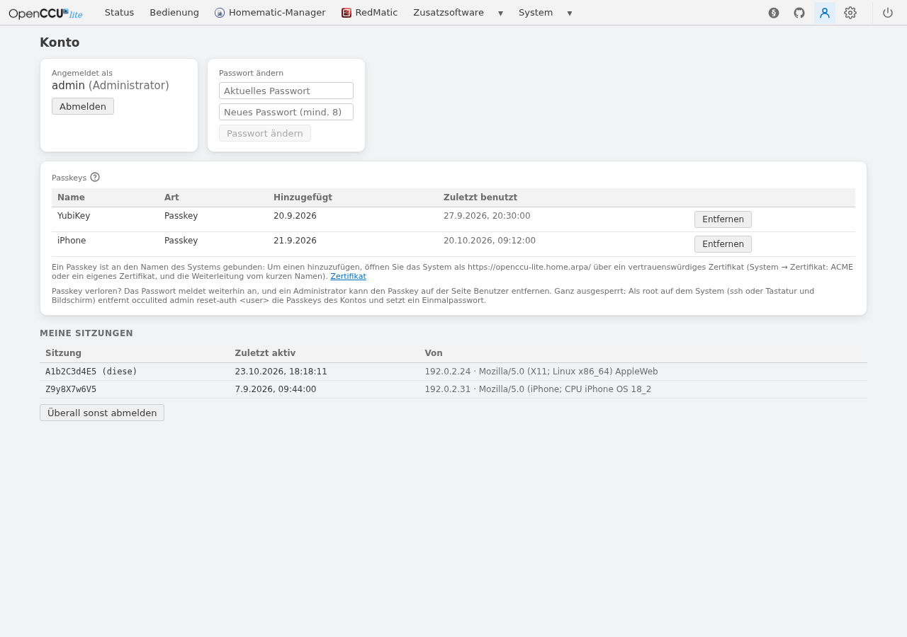</picture>

Das eigene Konto: wer angemeldet ist, Abmelden, Passwort ändern, die eigenen **Passkeys** (hinzufügen, entfernen,
wann zuletzt benutzt) und die eigenen Sitzungen, mit „Überall sonst abmelden“. Ein Passkey ist an den Namen des
Systems gebunden; um einen hinzuzufügen, öffnen Sie das System unter seinem Namen über ein vertrauenswürdiges
Zertifikat (System → Zertifikat).

### Lizenzen

<picture><source media="(prefers-color-scheme: dark)" srcset="28-lizenzen-dunkel.png">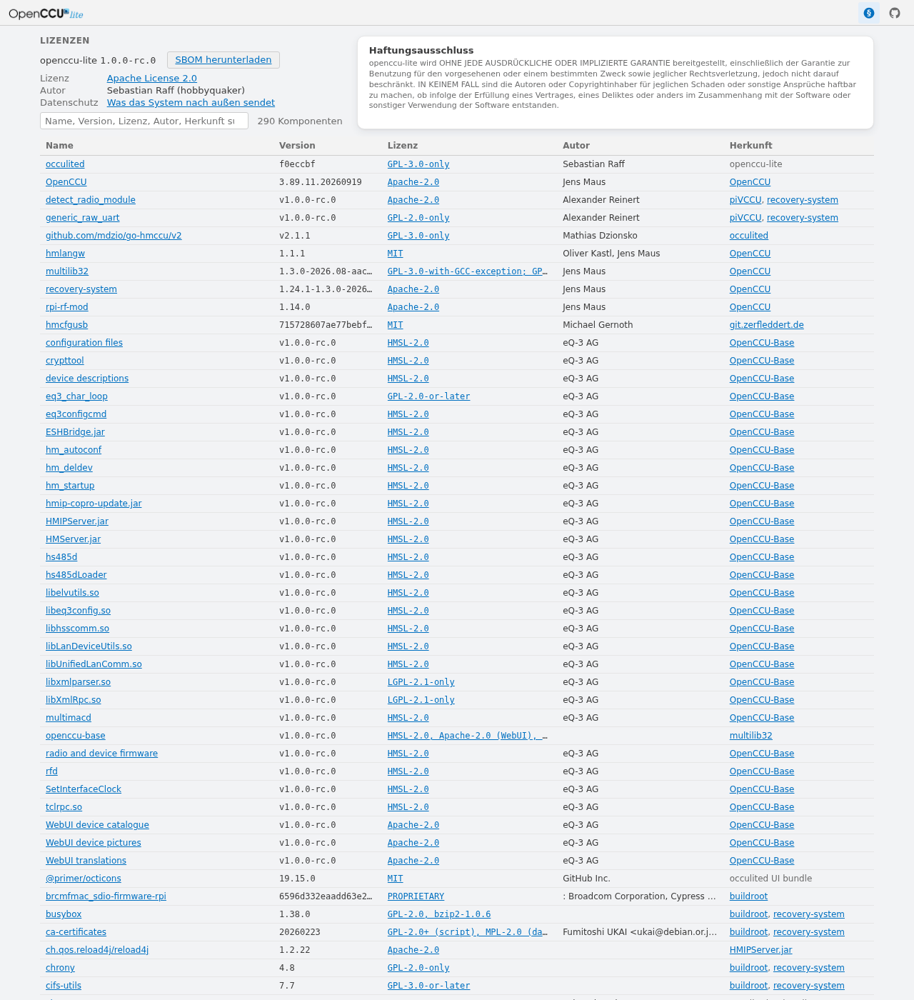</picture>

Die Version und Lizenz von openccu-lite, der Haftungsausschluss, der Link auf die Datenschutzhinweise
([privacy.md](../privacy.md)) und die Liste aller Bestandteile mit Version, Lizenz, Autor und Herkunft (im Bild nur
ihr Anfang; ein System bringt einige hundert mit, das Suchfeld filtert sie). „SBOM herunterladen“ liefert dieselbe
Liste als Software Bill of Materials.

### Abmelden, Neu starten und Herunterfahren

<picture><source media="(prefers-color-scheme: dark)" srcset="29-ausschalten-dunkel.png">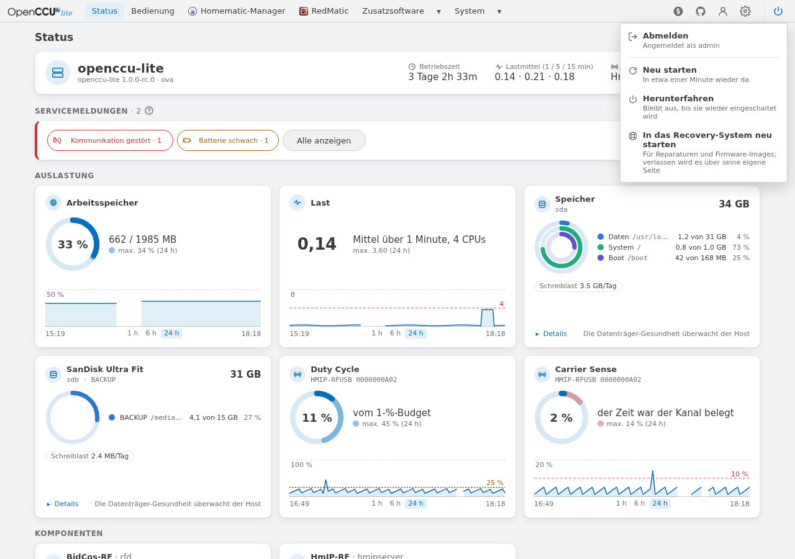</picture>

Der Knopf ganz rechts meldet ab, startet das System neu, fährt es herunter oder startet in das Recovery-System, das
für Reparaturen und das Einspielen von Firmware-Images gedacht ist.

## Zusatzsoftware

<picture><source media="(prefers-color-scheme: dark)" srcset="30-zusatzsoftware-dunkel.png">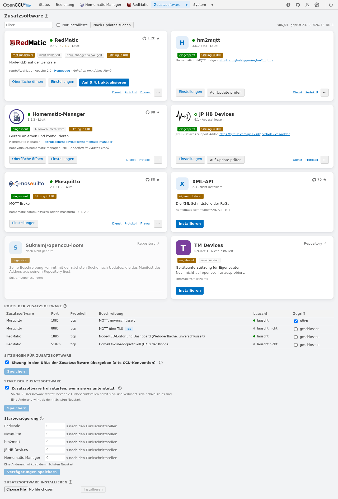</picture>

Installierte Addons und der **Katalog** auf einer Seite. Jede Karte zeigt Version, Zustand und Hinweise: ob das Addon
eingesperrt unter einem eigenen Benutzer oder als `root` läuft, ob es seine Anforderungen deklariert hat, ob es einen
API-Token bekommt. Von hier aus öffnen Sie die Oberfläche eines Addons und seine Einstellungen, installieren Updates
und springen zu seinem Dienst, seinem Protokoll und seinen Firewall-Regeln. Katalogeinträge, die noch nicht
installiert sind, installiert ein Klick. „Nach Updates suchen“ fragt den Katalog und die Addons selbst.

Darunter die **Ports der Zusatzsoftware** mit der Wahl, ob die Firewall sie öffnet, die Übergabe der Sitzung in den
Adressen der Addons (die alte CCU-Konvention, die manche Addons noch brauchen), der frühe Start der Addons, die das
unterstützen, eine **Startverzögerung** je Addon (damit sich bei einer großen Installation nach einem Neustart nicht
alle in derselben Sekunde mit den Funkschnittstellen verbinden) und die Installation eines Addons aus einer Datei.
Addons mit eigener Oberfläche lassen sich im Menü neben „Zusatzsoftware“ anheften und öffnen dann innerhalb der
Oberfläche. Mehr in [addons.md](../addons.md).

### Das Menü der Zusatzsoftware und angeheftete Addons

<picture><source media="(prefers-color-scheme: dark)" srcset="31-zusatzsoftware-menue-dunkel.png">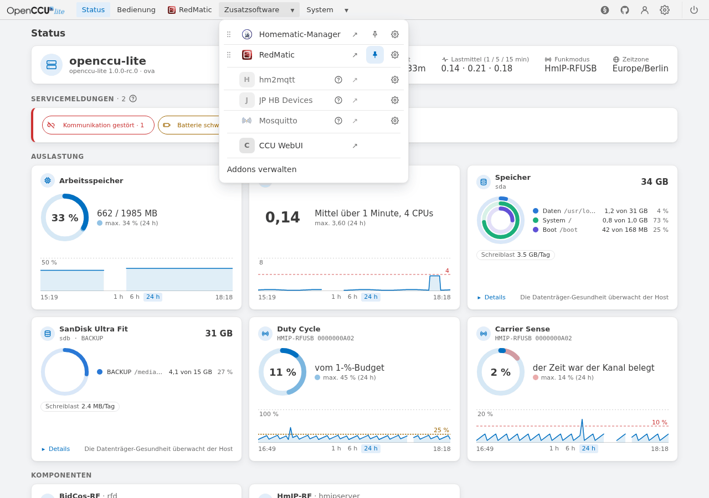</picture>

Der Pfeil neben **Zusatzsoftware** in der Kopfleiste öffnet das Menü der Addons. Oben stehen die Addons mit eigener
Oberfläche: ein Klick öffnet sie innerhalb der Weboberfläche, ↗ in einem neuen Tab, ⚙ ihre Einstellungen. Die Griffe
links ändern die Reihenfolge. Darunter die Addons ohne eigene Oberfläche (nur mit ihren Einstellungen), dann weitere
Links wie die alte CCU-WebUI und unten „Addons verwalten“, die Seite oben.

<picture><source media="(prefers-color-scheme: dark)" srcset="32-zusatzsoftware-angeheftet-dunkel.png">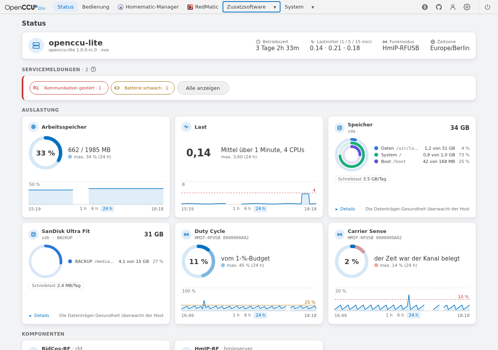</picture>

Im ersten Bild ist RedMatic schon angeheftet und steht mit seinem Symbol als eigener Reiter in der Kopfleiste. Die
**Stecknadel** neben dem Homematic Manager heftet auch ihn an: Er steht dann ebenfalls als Reiter zwischen Bedienung
und Zusatzsoftware, mit seinem eigenen Symbol, und ist mit einem Klick erreichbar. Ein zweiter Klick auf die
Stecknadel löst ein Addon wieder. Angeheftete Addons und ihre Reihenfolge gehören zum Benutzerkonto und gelten in
jedem Browser; auf den übrigen Bildern dieses Rundgangs sind beide angeheftet.

## Homematic Manager

openccu-lite hat keine eigene Geräteverwaltung. Anlernen, Konfigurieren und Direktverknüpfungen erledigt der
[Homematic Manager](https://github.com/hobbyquaker/homematic-manager#readme): auf openccu-lite ist er *das* Werkzeug
dafür. Er wird aus dem Katalog installiert und öffnet innerhalb der Weboberfläche, angeheftet als eigener Reiter oder
über das Menü der Zusatzsoftware. Die Bilder zeigen ihn mit seinen eigenen Beispieldaten; oben links wählen Sie die
Schnittstelle (BidCos-RF, HmIP-RF, Wired, VirtualDevices), daneben die Reiter.

<picture><source media="(prefers-color-scheme: dark)" srcset="33-hmm-geraete-dunkel.png">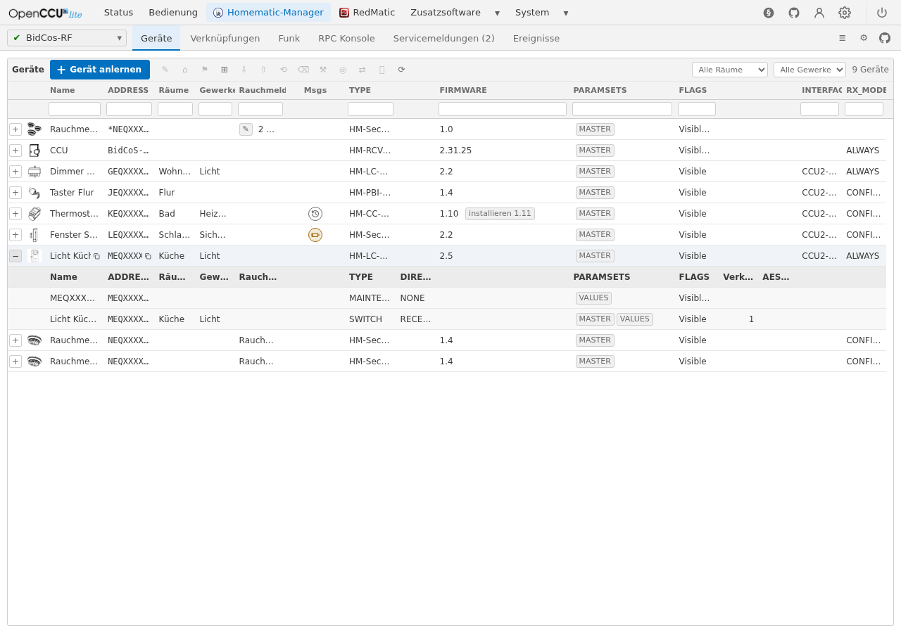</picture>

**Geräte:** alle Geräte einer Schnittstelle mit Bild, Name, Adresse, Räumen, Gewerken, Typ, Firmware und Paramsets;
ein Gerät lässt sich aufklappen und zeigt seine Kanäle. Die Werkzeugleiste benennt Geräte um, ordnet sie Räumen und
Gewerken zu, repariert ihre Konfiguration, tauscht und löscht sie. In der Spalte Firmware steht, wenn eine neuere
Firmware für das Gerät bereitliegt; „installieren“ spielt sie von hier aus ein.

<picture><source media="(prefers-color-scheme: dark)" srcset="34-hmm-anlernen-dunkel.png">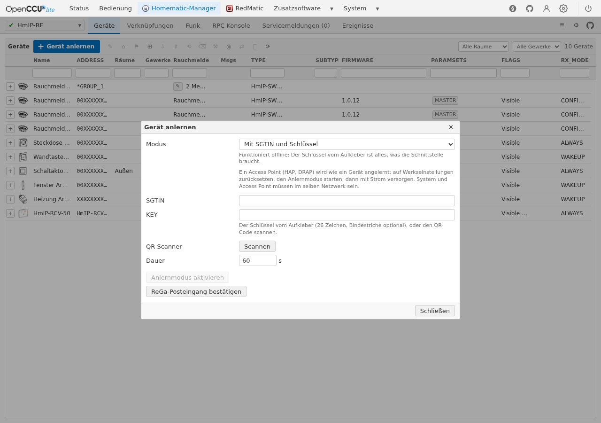</picture>

**Gerät anlernen:** für HmIP mit SGTIN und Schlüssel vom Aufkleber (auch per QR-Scanner), nur mit der SGTIN über den
Schlüsselserver oder ohne SGTIN im Anlernmodus; für BidCos im Anlernmodus oder über die Seriennummer. Access Points
(HAP, DRAP) werden wie Geräte angelernt.

<picture><source media="(prefers-color-scheme: dark)" srcset="35-hmm-parameter-dunkel.png">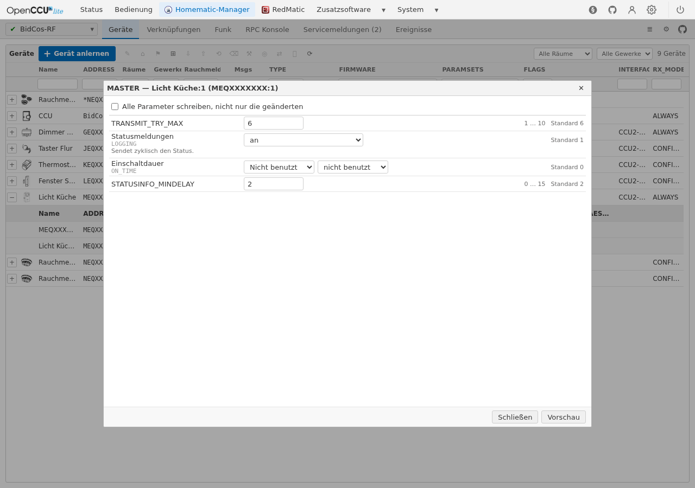</picture>

**Parameter:** ein Klick auf MASTER (oder VALUES) öffnet die Parameter eines Geräts oder Kanals mit Wertebereichen,
Standardwerten und Klartext für Aufzählungen und Zeiten. Geschrieben werden nur die geänderten Werte; „Vorschau“ zeigt
vor dem Schreiben, was sich ändert.

<picture><source media="(prefers-color-scheme: dark)" srcset="36-hmm-verknuepfungen-dunkel.png"></picture>

**Verknüpfungen:** Direktverknüpfungen zwischen Sender und Empfänger anlegen und bearbeiten, mit den Profilen wie auf
der CCU (hier „Treppenhauslicht“) oder in der Expertenansicht mit allen Parametern, dazu eigene Vorlagen.

<picture><source media="(prefers-color-scheme: dark)" srcset="70-hmm-funk-dunkel.png"></picture>

**Funk:** die Funkschnittstellen mit Duty Cycle und Carrier Sense und je Gerät die Empfangsstärke (RSSI) in beide
Richtungen und die Zahl der Ausfälle. Für BidCos-RF lässt sich hier wählen, über welches Gateway ein Gerät funkt, oder
das am besten hörende für alle Geräte vorschlagen.

<picture><source media="(prefers-color-scheme: dark)" srcset="71-hmm-router-dunkel.png"></picture>

Bei HmIP-RF zeigt **Router** die Geräte, die Funkverkehr für andere weiterleiten können: ob Routing an ist (ein- und
ausschaltbar), ihre Empfangsstärke und ihre Routing-Tabelle.

<picture><source media="(prefers-color-scheme: dark)" srcset="72-hmm-routing-netz-dunkel.png"></picture>

„Graph“ liest die Routing-Tabellen der Router nacheinander per Funk und zeichnet daraus das Netz: welches Gerät über
welchen Router den Access Point erreicht, mit Empfangsstärke und Zahl der Hops, rechts dieselben Routen als Tabelle.
Das Bild zeigt ein Beispielnetz mit einem Router.

<picture><source media="(prefers-color-scheme: dark)" srcset="37-hmm-servicemeldungen-dunkel.png"></picture>

**Servicemeldungen:** die offenen Meldungen der Geräte einer Schnittstelle, etwa leere Batterien oder
Kommunikationsstörungen, einzeln oder alle zu bestätigen.

<picture><source media="(prefers-color-scheme: dark)" srcset="74-hmm-rpc-konsole-dunkel.png"></picture>

**RPC-Konsole:** jede RPC-Methode der Schnittstelle von Hand aufrufen, mit einem Formular für ihre Argumente, dem
genauen Aufruf darüber und der rohen Antwort. Der Reiter **Ereignisse** liest die Ereignisse der Schnittstelle live
mit, mit Filtern und einem Zähler je Gerät.

## Namen, Räume und Gewerke

Namen, Räume und Gewerke pflegen Sie direkt in der **Bedienung**; eine eigene Namensseite gibt es nicht. Die beiden
Knöpfe unten in der linken Spalte öffnen die Kanäle, die noch keinem Raum und Gewerk zugeordnet sind, und die
Verwaltung der Räume und Gewerke:

<picture><source media="(prefers-color-scheme: dark)" srcset="38-namen-raeume-dunkel.png"></picture>

Räume und Gewerke hinzufügen, umbenennen und löschen, auf jeder Ebene: ein Raum kann weitere Räume enthalten
(Obergeschoss → Bad).

<picture><source media="(prefers-color-scheme: dark)" srcset="39-namen-kanal-dunkel.png"></picture>

Ein langer Druck auf eine Kachel in einem Raum oder Gewerk öffnet ihren Kanal: hier bekommt er seinen Namen und seine
Räume und Gewerke. Ein **Anzeigename in der Bedienung** gilt nur für Sie selbst und nur in der Bedienung; der Name
darüber ist der, den jede Ansicht und jede App zeigt. In den Favoriten und im Baum verschiebt ein langer Druck die
Einträge in eine andere Reihenfolge. Namen, Räume und Gewerke einer alten CCU übernimmt das System beim Wechsel oder
über System → Sicherung; Addons wie der Homematic Manager lesen und schreiben dieselben Namen.

## Auf dem Smartphone

Die Oberfläche passt sich an schmale Bildschirme an: Die Kopfleiste wird zweizeilig, Tabellen und Karten stehen
untereinander.

<picture><source media="(prefers-color-scheme: dark)" srcset="53-handy-status-dunkel.png"></picture>

<picture><source media="(prefers-color-scheme: dark)" srcset="54-handy-bedienung-dunkel.png"></picture>

In der **Bedienung** liegen Räume, Gewerke und Favoriten hinter dem runden Knopf unten links; ein Tipp auf eine Kachel
öffnet die Bedienung des Kanals:

<picture><source media="(prefers-color-scheme: dark)" srcset="55-handy-bedienung-kanal-dunkel.png"></picture>

### Die Bedienung als eigene App

Die Bedienung lässt sich ohne Kopfleiste und System-Menü nutzen, wie eine eigene App:

1. Unter **Einstellungen → Bedienung** den Haken bei **„Bedienung als ganzes Fenster zeigen“** setzen (und als
   Startseite „Bedienung“ wählen). Die Reiterleiste und die Symbole verschwinden dann, solange die Bedienung offen ist.
2. Die Seite zum Startbildschirm hinzufügen: auf dem **iPhone** in Safari über das Teilen-Symbol **„Zum
   Home-Bildschirm“**, unter **Android** in Chrome über das Menü **„Zum Startbildschirm hinzufügen“** (oder „App
   installieren“). Das System bringt dafür ein App-Manifest mit: Das Symbol öffnet die Bedienung (`/app/`) in einem
   eigenen Fenster ohne Adressleiste.

<picture><source media="(prefers-color-scheme: dark)" srcset="56-handy-app-vollbild-dunkel.png"></picture>

So sieht die Bedienung dann aus: nur die Kacheln. Der runde Knopf öffnet das Menü mit Räumen und Gewerken; unten führen
die Symbole zum Abmelden, zu den Kanälen ohne Raum und Gewerk, zur Verwaltung der Räume und Gewerke, zum Konto und zu
den Einstellungen:

<picture><source media="(prefers-color-scheme: dark)" srcset="57-handy-app-menue-dunkel.png"></picture>
